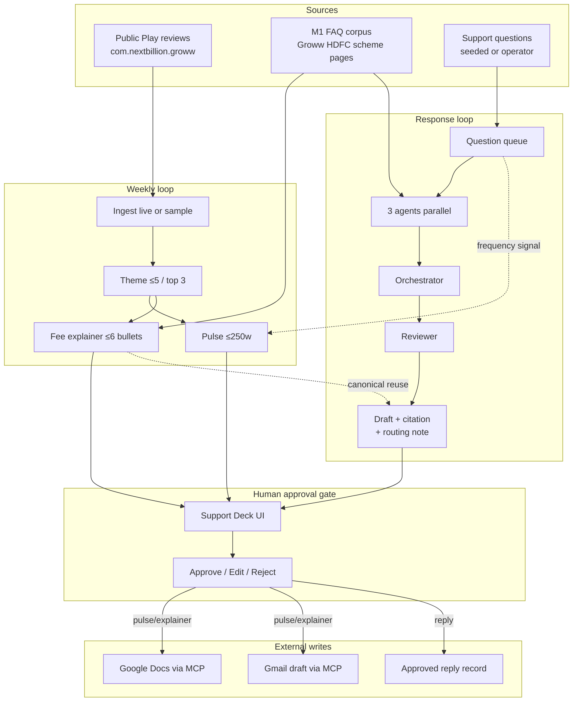
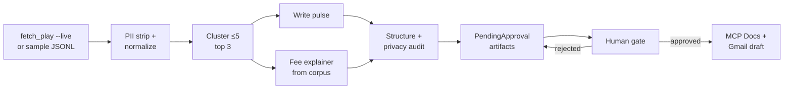
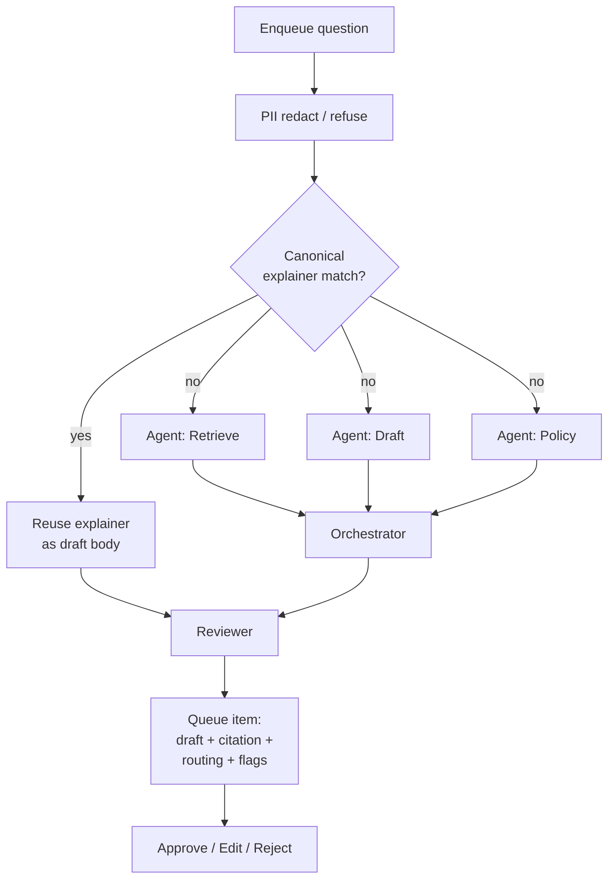
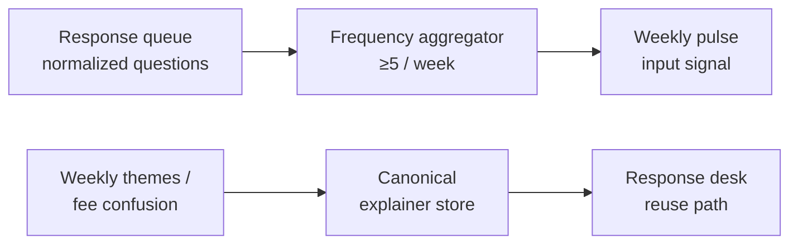

# Architecture: Groww Integrated Support + Product Loop (Support Deck)

## 1. Purpose

This document defines the system architecture for the **Support Deck integrate phase**: one deployed application that runs Groww’s **support loop** (cited reply drafts) and **product loop** (weekly review pulse + fee explainer) with a **coded human approval gate** before any Doc append, Gmail draft, or outbound reply.

It implements [ProblemStatement.md](./ProblemStatement.md) by composing:

| Milestone | What exists | Role in this architecture |
|-----------|-------------|---------------------------|
| M1 FAQ | `frontend/` + `backend/` + `Docs-FAQ/` | Official corpus + facts-only refusal behind the response loop |
| M2 Pulse | `pulse/` + `Docs-MCP-&-RAG/` | Live Play ingest → themes → pulse artifacts; MCP Docs/Gmail delivery |
| M3 + Integrate | **New** under `support-deck/` (this track) | Multi-agent desk, fee explainer, approval gate, dual-loop link, unified UI, evals, deploy |

**Design priorities (in order):**

1. Compliance and privacy (facts-only; no PII in UI, logs, or agent state; public reviews only)
2. Human gate before any external write (Doc / Gmail / reply)
3. Grounding (every factual claim → one corpus source link; every theme → review ids + window)
4. Dual-loop connection (repeat questions ↔ pulse; fee confusion → canonical explainer reuse)
5. Compose existing M1/M2 rather than replace Vercel/Railway/pulse pipelines
6. MCP-first Google delivery (same MCP-Server-1 path as M2)

**Sibling docs:** [Docs-FAQ/Architecture.md](../Docs-FAQ/Architecture.md), [Docs-MCP-&-RAG/Architecture.md](../Docs-MCP-&-RAG/Architecture.md). This file owns integrate-level decisions; track-specific detail stays in those docs unless overridden here.

---

## 2. Design Principles

| Principle | Implication |
|-----------|-------------|
| Two loops, one product | Weekly (product) and Response (support) share state via explicit connectors—not ad-hoc copy-paste |
| Live reviews first | Primary ingest = public Play fetch (`pulse --live`); sample JSONL fallback for demo/CI—**not** a CSV-primary design |
| Quotes and claims are sacred | Verbatim review quotes; factual answers only from M1 corpus (or explicit not-covered) |
| Fail closed | Advice, returns, PII, empty retrieval → refuse/redact; failed audit → do not publish |
| Approve the action, not the day | Each Doc append, Gmail draft, and reply draft is a discrete approval unit |
| MCP owns Google auth | No bespoke Google OAuth/REST as the primary Docs/Gmail path |
| Reviews ≠ FAQ corpus | Do not index store reviews into Chroma; reviews ground themes/quotes only |
| Code over prompts | Caps, PII redaction, and scope checks enforced in validators, not only system prompts |

---

## 3. High-Level System Context



**Product focus:** [Groww on Google Play](https://play.google.com/store/apps/details?id=com.nextbillion.groww&hl=en_IN) (`com.nextbillion.groww`).

---

## 4. Scope Boundary

### 4.1 In Scope

- Live public Play review ingest for Groww (8–12 week window) + sample JSONL fallback
- Theming ≤5 / pulse top 3 / ≤250 words / 3 verbatim quotes / 3 grounded actions
- Fee explainer (≤6 bullets, 2 official links, last-checked) from M1 corpus policy
- Three parallel agents + orchestrator + reviewer → queue drafts
- Dual-loop connection (frequency → pulse; fee confusion → explainer reuse)
- Unified UI: queue, pulse, sources, approval, explainers
- Coded approval gate before MCP Docs append, Gmail draft, and reply finalize
- Assembled-system evals (feasibility, edit isolation, grounding/compliance)
- Deployed web app composing M1/M2 capabilities (prefer update-in-place / shared packages over discarding hosts)

### 4.2 Out of Scope

- CSV as the primary review product path
- Login-gated Play Console / App Store Connect scraping
- Indexing review text into the FAQ Chroma index
- Auto-send of Gmail (draft only); silent Doc writes without approval
- Investment advice, buy/sell language, return/performance figures
- Full ticketing / CRM / realtime analytics product
- Replacing MCP with LangChain Google toolkits as the primary Docs/Gmail path

---

## 5. Recommended Tech Stack

| Layer | Choice | Rationale |
|-------|--------|-----------|
| Support Deck UI | Next.js (extend or sibling to `frontend/`) | Matches M1; one operator surface for both loops |
| Support Deck API | FastAPI (extend `backend/` and/or new `support-deck/` package that calls `backend` + `pulse`) | Reuse RAG/refusal; keep Python LLM stack consistent |
| Review ingest / themes / pulse | Existing `pulse/` (`fetch_play`, clean, theme, write, audit) | Do not reimplement M2; wrap and extend |
| Fee explainer | New module (LangChain + Groq) calling M1 retrieval/corpus URLs | Facts-only; two links + last-checked enforced by schema |
| Multi-agent desk | LangChain / plain async Python agents + Groq | Parallel retrieve / draft / policy; structured outputs |
| Queue + approvals store | SQLite or Postgres (lightweight JSON-document tables OK for v1) | Durable queue status + approval audit trail |
| Docs / Gmail | [MCP-Server-1](https://github.com/FallenOne1701/MCP-Server-1): `google_docs_append_content`, `gmail_create_draft` | Same as M2; gate sits **before** tool calls |
| Scheduler | GitHub Actions weekly job (existing `pulse-weekly.yml`) **or** API-triggered run | Artifacts generated offline; publish only after UI approval |
| Secrets | `GROQ_API_KEY` in app env; Google OAuth stays in MCP server | Never commit secrets; no Google client secrets in app for primary path |

**Repo shape (target):**

```text
RAG-1/
├── Docs-FAQ/
├── Docs-MCP-&-RAG/
├── DOCS-AI-Agent-Support-Deck/   # this track’s docs
├── frontend/                     # FAQ UI (compose / extend for Support Deck views)
├── backend/                      # FAQ RAG + refusal (expose services to desk)
├── pulse/                        # weekly ingest → theme → pulse artifacts
└── support-deck/                 # NEW: queue, agents, explainer, approval, connectors, evals
    ├── src/
    ├── prompts/
    ├── data/                     # seed questions, fixture explainers (no PII)
    └── README.md
```

Exact split between “extend `frontend`/`backend`” vs “thin `support-deck` service” may follow implementation planning; architecture requires **clear package boundaries** and **no silent coupling** that bypasses the approval gate.

---

## 6. Logical Architecture

### 6.1 Weekly loop



**Reuse:** `pulse/src/fetch_play.py`, `clean.py`, `theme.py`, `write_pulse.py`, `audit.py`, `run_pulse.py`.

**New:**

- Fee-confusion detector (theme/keyword + rating signal → “fees/charges” candidate)
- Fee explainer generator (corpus-grounded)
- Write path stops at **PendingApproval**; MCP runs only after gate

### 6.2 Response loop



### 6.3 Dual-loop connectors



| Connector | Trigger | Effect |
|-----------|---------|--------|
| Frequency → pulse | Same/equivalent question ≥ ~5 times in rolling 7 days | Pulse includes callout with count + window |
| Fee confusion → explainer | Weekly themes flag fees/charges confusion | Upsert canonical explainer; desk prefers reuse over fresh draft |

Normalization for “same question”: lowercase, strip punctuation, light paraphrase bucket (embedding or hash of normalized text)—must be deterministic enough for evals.

---

## 7. Review Source Model

Aligned with M2; integrate inherits these rules.

### 7.1 Source policy

| Allowed | Notes |
|---------|-------|
| Public Play listing for `com.nextbillion.groww` via `google-play-scraper` / `pulse --live` | Primary path |
| Checked-in sample JSONL under `pulse/data/samples/` | Demo / CI fallback |
| Emergency offline export matching the **same normalized schema** | Not product design; not CSV-primary |

**Disallowed:** Play Console login scrapes; gray-market dumps; mixing review text into FAQ Chroma.

### 7.2 Canonical review record

Same as M2 after normalize: `review_id`, `store`, `app_id`, `rating`, `text`, `created_at`, optional `theme_id`. **Never persist** reviewer name, email, device id, IP, account id.

### 7.3 Windowing

- Lookback **8–12 weeks** (default 10 via `PULSE_LOOKBACK_WEEKS`)
- Every theme count and pulse header must state the window

---

## 8. Multi-Agent Response Desk

The problem statement requires three agents in parallel, an orchestrator, and a reviewer. Roles are fixed here:

| Role | Runs | Responsibility | Output |
|------|------|----------------|--------|
| **Retrieve** | Parallel | Query M1 corpus / retrieval API; list what was searched | Passages + source URLs + “searched” list |
| **Draft** | Parallel | Propose ≤3-sentence facts-only reply from retrieve context (or not-covered stub) | Draft text |
| **Policy** | Parallel | Classify advice / returns / PII / OOS; recommend refuse or allow | Policy verdict + reasons |
| **Orchestrator** | After parallel | Merge: prefer refuse if policy fails; else one draft + exactly one citation; set routing note | Candidate reply package |
| **Reviewer** | After orch | Check caps, citation present, no PII patterns, grounding; attach flags | Pass/fail + flags for UI |

**Routing notes (examples):** `answer`, `reuse_explainer`, `not_covered`, `escalate_human`.

**Contract per queue item:**

```json
{
  "question_id": "q-...",
  "status": "drafted",
  "draft": "≤3 sentences or null",
  "citation_url": "https://... or null",
  "routing_note": "not_covered",
  "searched": ["scheme page A", "..."],
  "reviewer_flags": [],
  "explainer_id": null
}
```

Statuses: `pending` → `drafted` → `approved` | `rejected` | `not_covered` (terminal or awaiting human confirm).

---

## 9. Fee Explainer

### 9.1 When generated

- Weekly loop detects fee/charge confusion in themes **or** operator triggers regenerate
- Stored as a **canonical explainer** versioned by `explainer_id` + `last_checked`

### 9.2 Contract

| Field | Rule |
|-------|------|
| Bullets | ≤6, facts-only |
| Links | Exactly **2** official source URLs from M1 corpus policy |
| last_checked | ISO date |
| Prohibited | Advice, buy/sell, returns/performance figures |

### 9.3 Reuse

Response loop checks explainer store **before** full parallel draft when the question matches fee/charge intents. On hit: draft body = explainer summary (still ≤3 sentences for the **reply** surface, with links preserved in citation/sources panel); routing_note = `reuse_explainer`.

---

## 10. Human Approval Gate

### 10.1 Why coded

M2 today: generate artifacts → operator/MCP runbook. Integrate requires a **system gate**: no MCP tool call or reply finalize without an explicit approve of **that** action.

### 10.2 Approval unit

```json
{
  "action_id": "act-...",
  "type": "docs_append | gmail_draft | reply_finalize",
  "payload_preview": { "summary": "...", "destinations": ["doc_id:...", "to:..."] },
  "content_hash": "...",
  "status": "pending_approval | approved | rejected",
  "edited_content": null
}
```

### 10.3 Rules

| Rule | Behavior |
|------|----------|
| Preview before write | Approval screen shows exact text + destination |
| Edit isolation | Editing one draft/action changes only that record |
| No cascade | Approving Docs append does **not** auto-create Gmail draft (separate action or explicitly bundled multi-select with two confirmations—default = separate) |
| Reject | Leaves other queue/actions untouched; no MCP call |
| Audit | Persist who/when (operator id optional for demo; timestamp required) without storing PII from content beyond the approved artifact |

### 10.4 MCP boundary

```mermaid
sequenceDiagram
  participant UI as SupportDeckUI
  participant API as SupportDeckAPI
  participant Gate as ApprovalStore
  participant MCP as MCPServer1

  UI->>API: Request publish pulse
  API->>Gate: Create pending actions
  UI->>UI: Show approval screen
  UI->>API: Approve action_id
  API->>Gate: Mark approved
  API->>MCP: google_docs_append_content
  API->>MCP: gmail_create_draft
  Note over API,MCP: Only after approve; never from CI alone
```

CI (`pulse-weekly.yml`) may still produce artifacts; **publish remains gated** in the app (or explicit operator approval workflow).

---

## 11. Interface Architecture

Minimum views (problem statement):

| View | Data | Actions |
|------|------|---------|
| Queue | Questions, drafts, citations, flags, status | Open item; edit draft; approve/reject |
| Weekly pulse | Themes, quotes, counts, window, review-id traces | Trigger run; open approval for publish |
| Sources | Claim → URL + last-checked | Read-only audit |
| Approval | Payload + destination list | Approve / reject / edit-then-approve |
| Explainers | Canonical fee explainers | View; mark active; see reuse count |

Not a general analytics dashboard—operator console for the two loops and the gate.

---

## 12. Data Stores (logical)

| Store | Contents | Notes |
|-------|----------|-------|
| Review clean JSONL | M2 cleaned reviews | Owned by `pulse/`; no PII |
| Themes / pulse out | `themes.json`, `pulse-*.md` | Pending until approved publish |
| Explainer store | Canonical explainers | Used by desk reuse path |
| Question queue | Items + drafts + flags | Status machine above |
| Frequency aggregate | Normalized question → count + window | Feeds pulse signal |
| Approval log | Actions + outcomes | For eval “correctness of edits” |
| FAQ corpus / Chroma | M1 only | Read via backend retrieve; no review text |

---

## 13. Scope Enforcement (code)

| Check | Where |
|-------|-------|
| Advice / buy-sell / returns | Policy agent + deterministic keyword/classifier (reuse M1 refuse patterns) |
| PII inbound | Redact/refuse before agents; scan logs |
| PII outbound | Audit pulse, explainer, drafts before approval preview |
| Caps | Validators: themes ≤5, pulse words ≤250, explainer bullets ≤6, reply sentences ≤3 |
| Citation | Orchestrator requires one URL or `not_covered` |
| Grounding | Quotes must match cleaned review text; claims must map to corpus chunk/URL |

Fail closed: do not enqueue a “successful” answer that fails these checks.

---

## 14. Deployment Composition

| Component | Today | Integrate target |
|-----------|-------|------------------|
| FAQ UI | Vercel `frontend/` | Add Support Deck routes **or** deploy composed UI; update-in-place preferred |
| FAQ API | Railway `backend/` | Expose retrieve/refuse to desk; keep `/api/ask` working |
| Pulse | Local/CI `pulse/` | Called by Support Deck API or scheduled job; artifacts land in shared out/ |
| MCP | Operator / Cursor MCP | Invoked by gated server-side or documented operator bridge after approve |
| Support Deck | — | New deployable surface binding the above |

**Non-goal:** Destroy existing FAQ deployments. Prefer compose and update-in-place.

---

## 15. Security and Privacy

- No PAN, Aadhaar, account numbers, OTPs, emails, phones, reviewer usernames, device IDs in dataset, UI, logs, or agent state
- Public reviews only; strip identity fields at ingest (M2 `clean`)
- Secrets: Groq in env; Google via MCP only for primary path
- Approval and agent traces store content hashes / redacted previews where possible for evals

---

## 16. Evaluations (architecture mapping)

| Eval (from PS) | What to instrument |
|----------------|--------------------|
| Feasibility | Every queue item → draft or not_covered; themes have review ids + window; caps hold; weekly run completes to PendingApproval without manual steps mid-pipeline |
| Correctness of edits | Diff store before/after edit, approve, reject—no cross-item mutation |
| Grounding and compliance | Sample 15 claims → source or review id; OOS → names searched; advice/returns/PII cases refused/redacted with clean logs |

Eval harness lives under `support-deck/` (or `DOCS-AI-Agent-Support-Deck/eval` results linked from README).

---

## 17. End-to-End Sequences

### 17.1 Weekly publish

1. Trigger weekly job (API or CI) → `pulse` live/sample → themes + pulse (+ fee explainer).
2. Auditors pass → create `PendingApproval` actions for Docs + Gmail.
3. Operator opens Approval view → approves Docs (and separately Gmail, unless explicitly bundled).
4. API calls MCP tools once per approved action.
5. Frequency signals from the queue are merged into the next pulse inputs.

### 17.2 Support reply

1. Question enqueued → PII gate.
2. Explainer match? → reuse path; else parallel Retrieve / Draft / Policy.
3. Orchestrator + Reviewer → `drafted` (or `not_covered`).
4. Human approve/edit/reject **that** item only.
5. Increment frequency aggregate for connector A.

---

## 18. Risks and Mitigations

| Risk | Mitigation |
|------|------------|
| Live Play fetch flaky | Sample JSONL fallback; cache last good raw JSONL |
| MCP cannot create Docs | Pre-create Doc; store doc id; append only (same as M2) |
| Agents invent citations | Reviewer + URL allowlist from corpus metadata |
| Dual-loop too fuzzy | Fixed threshold (≥5/week) + normalized question key; demo seeds |
| Scope creep into CRM | Hard UI/scope boundary in §4 and §11 |

---

## 19. Summary

Support Deck architecture composes **live Play → pulse/explainer** and **multi-agent cited drafts** behind a **single human approval gate**, with MCP Docs/Gmail as the only primary Google write path. M1 supplies corpus and refusal; M2 supplies ingest and pulse; new `support-deck/` code owns agents, explainers, connectors, queue, gate, UI binding, and assembled-system evals—without folding reviews into the FAQ index or publishing anything without an explicit approve.
