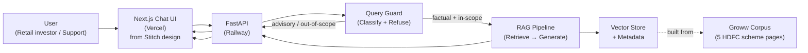
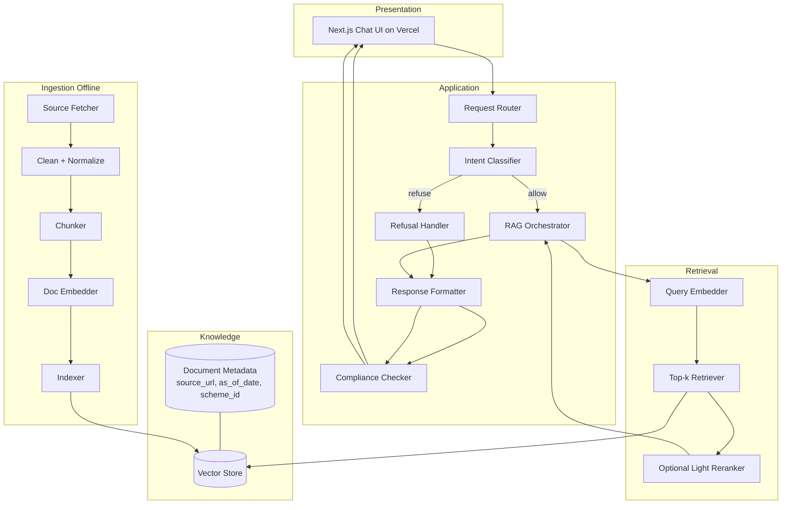
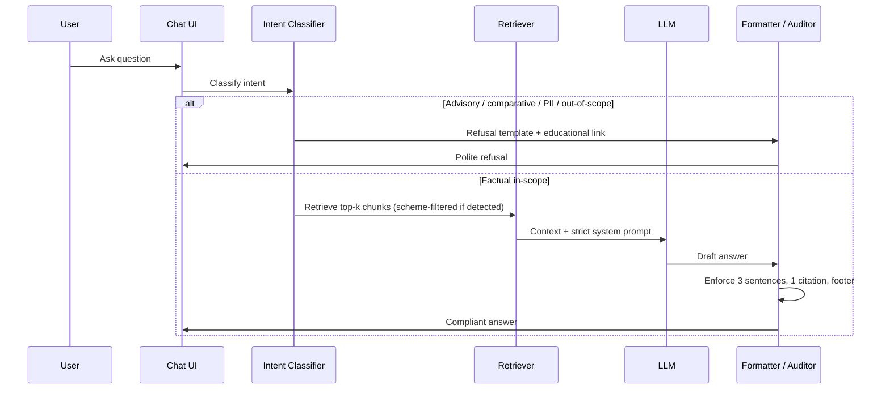
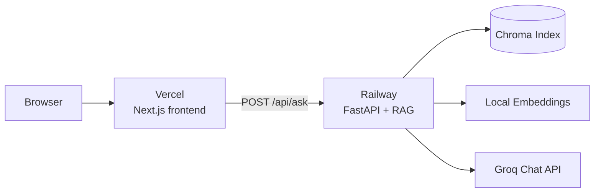

# Architecture: Mutual Fund FAQ Assistant (Facts-Only RAG)

## 1. Purpose

This document defines the system architecture for a **facts-only mutual fund FAQ assistant**. The system answers objective, verifiable questions about a curated set of HDFC mutual fund schemes using Retrieval-Augmented Generation (RAG), with answers grounded in a **fixed corpus of Groww scheme pages** for those funds.

**Design priorities (in order):**

1. Compliance and safety (no advice, no PII, no speculative content)
2. Answer accuracy and verifiability (source-backed citations to Groww scheme URLs)
3. Simplicity and maintainability (lightweight stack)
4. Transparent UX from Stitch design, served as Next.js on Vercel; RAG API on Railway

---

## 2. Design Principles

| Principle | Implication |
|-----------|-------------|
| Facts over intelligence | Prefer retrieval + constrained generation over open-ended reasoning |
| Groww corpus only | Knowledge is limited to the allowlisted Groww mutual-fund scheme URLs below |
| Fail closed | Ambiguous, advisory, comparative, or out-of-corpus queries are refused |
| Short & citable | Max 3 sentences, exactly one citation, last-updated footer |
| Privacy by design | No collection/storage of PAN, Aadhaar, accounts, OTPs, email, or phone |
| Transparent UX | Persistent disclaimer: “Facts-only. No investment advice.” |

---

## 3. High-Level System Context



**UI role:** Google Stitch export in `stitch_hdfc_mutual_fund_faq_assistant/` is the visual source of truth; implement as React/Next.js on Vercel.

**Groww role:** Groww is the **sole knowledge corpus** (and visual inspiration only — do not copy Groww brand assets). Each supported scheme is ingested from its public Groww mutual-fund URL. Citations in answers must point back to that same Groww `source_url`.

---

## 4. Scope Boundary

### 4.1 In Scope

- 1 AMC: **HDFC Mutual Fund**
- 5 schemes (category diversity):
  - HDFC Mid Cap Fund – Direct Growth
  - HDFC Small Cap Fund – Direct Growth
  - HDFC Gold ETF Fund of Fund – Direct Plan Growth
  - HDFC Large Cap Fund – Direct Growth
  - HDFC ELSS Tax Saver Fund – Direct Plan Growth
- Factual FAQ topics: expense ratio, exit load, min SIP, ELSS lock-in, riskometer, benchmark, statement/capital-gains download process
- Polite refusal for advisory / comparative / personal-finance advice queries
- Next.js chat UI (from Stitch) with welcome message, 3 example questions, visible disclaimer; FastAPI on Railway

### 4.2 Out of Scope

- Portfolio advice, suitability, “best fund”, return projections
- Performance comparison / return calculation (link to the scheme’s Groww page only)
- User accounts, login, KYC, transaction flows
- Live market data streaming
- Multi-AMC corpus (beyond the selected HDFC set on Groww)
- Scraping or indexing AMC/AMFI/SEBI sites, other aggregators, blogs, or forums as knowledge (corpus is Groww-only)

---

## 5. Recommended Tech Stack

| Layer | Choice | Rationale |
|-------|--------|-----------|
| UI design | Google Stitch (`stitch_hdfc_mutual_fund_faq_assistant/`) | Approved high-fidelity source (`code.html` + `screen.png`) |
| Frontend | **Next.js (App Router) + React** on **Vercel** | Production web UI; ports Stitch Tailwind layout |
| Backend API | **FastAPI** on **Railway** | Serves RAG orchestrator; keeps Groq + Chroma off the frontend |
| Document loading | HTML fetch + BeautifulSoup (Groww scheme pages) | Corpus is public Groww HTML |
| Chunking | Fixed-size + overlap, scheme-aware metadata | Predictable retrieval |
| Embeddings | Local `sentence-transformers` (`BAAI/bge-small-en-v1.5`) | Groq has no embeddings API; index on backend |
| Vector store | ChromaDB (persisted with backend) | Fine for small corpus; lives with Railway service |
| LLM | **Groq** (`llama-3.3-70b-versatile`) | Fast constrained facts-only generation |
| Config / secrets | Railway env (`GROQ_API_KEY`); Vercel `NEXT_PUBLIC_API_URL` only | Never expose Groq key to the browser |

**Groq client note:** Use the OpenAI Python SDK pointed at `https://api.groq.com/openai/v1` with `GROQ_API_KEY` **on Railway only**. Chat/completions only — embeddings and indexing stay on the backend.

**Repo shape:** Monorepo — `frontend/` (Vercel) + `backend/` (Railway).

---

## 6. Logical Architecture



The system has **two pipelines**:

1. **Offline ingestion** — build/refresh the curated corpus index
2. **Online query** — classify → retrieve → generate → format → compliance-check

---

## 7. Corpus & Source Model

### 7.1 Source Policy

**Allowed (corpus = these Groww URLs only):**

| Scheme | Groww URL |
|--------|-----------|
| HDFC Mid Cap Fund – Direct Growth | https://groww.in/mutual-funds/hdfc-mid-cap-fund-direct-growth |
| HDFC Small Cap Fund – Direct Growth | https://groww.in/mutual-funds/hdfc-small-cap-fund-direct-growth |
| HDFC Gold ETF Fund of Fund – Direct Plan Growth | https://groww.in/mutual-funds/hdfc-gold-etf-fund-of-fund-direct-plan-growth |
| HDFC Large Cap Fund – Direct Growth | https://groww.in/mutual-funds/hdfc-large-cap-fund-direct-growth |
| HDFC ELSS Tax Saver Fund – Direct Plan Growth | https://groww.in/mutual-funds/hdfc-elss-tax-saver-fund-direct-plan-growth |

**Disallowed as knowledge sources:**

- AMC sites (e.g. hdfcfund.com), AMFI, SEBI pages (not part of this corpus)
- Other aggregators (Value Research, Moneycontrol, etc.), blogs, forums, social media
- Any Groww URL outside the five scheme pages above
- User-uploaded personal statements or account documents

**Note:** Refusal responses may still point users to a generic investor-education link (e.g. AMFI/SEBI) for *policy messaging*. That link is not indexed into the RAG corpus.

### 7.2 Document Types

| Type | Source | Typical facts covered |
|------|--------|------------------------|
| `groww_scheme_page` | One HTML page per scheme (table above) | Expense ratio, exit load, min SIP, riskometer, benchmark, lock-in (ELSS), plan/option labels, other on-page factual fields |
| Process FAQs | Only if present on the same Groww scheme pages | Statement / capital-gains *mentions* on-page; otherwise refuse as out-of-corpus |

Do not crawl linked-off domains from Groww pages into the index.

### 7.3 Chunk Metadata Schema

Every chunk stores:

```json
{
  "chunk_id": "hdfc-large-cap-fund-direct-growth-groww-c2",
  "scheme_id": "hdfc-large-cap-fund-direct-growth",
  "scheme_name": "HDFC Large Cap Fund - Direct Growth",
  "amc": "HDFC",
  "doc_type": "groww_scheme_page",
  "source_url": "https://groww.in/mutual-funds/hdfc-large-cap-fund-direct-growth",
  "as_of_date": "2025-11-17",
  "section": "expense_ratio",
  "text": "..."
}
```

Metadata enables:

- Scheme-scoped retrieval
- Exactly one citation URL in the answer (the scheme’s Groww page)
- `Last updated from sources: <date>` footer from `as_of_date` (ingest / page “as of” date captured at fetch time)

### 7.4 Chunking Strategy

- Prefer **semantic sections** on the Groww page (Expense Ratio, Exit Load, SIP, Riskometer, Benchmark, Lock-in, etc.) over blind splits
- Fallback: ~400–800 tokens with ~10–15% overlap
- Keep key-value / table rows as normalized text (e.g., `Expense Ratio (Direct): 0.xx%`)
- Do not merge facts from different schemes into one chunk
- Strip navigation, ads, and unrelated Groww chrome before chunking

---

## 8. Online Query Pipeline

### 8.1 Sequence



### 8.2 Intent Classification

Classify each query into one of:

| Intent | Action |
|--------|--------|
| `FACTUAL_SCHEME` | RAG answer |
| `FACTUAL_PROCESS` | RAG answer only if present on Groww scheme pages; else out-of-corpus refuse |
| `PERFORMANCE` | Soft-refuse + link the scheme’s Groww page only |
| `ADVISORY` | Refuse + educational link |
| `COMPARATIVE` | Refuse + educational link |
| `PII_SENSITIVE` | Refuse; do not echo or store identifiers |
| `OUT_OF_CORPUS` | Refuse; say corpus coverage is limited |
| `UNCLEAR` | Ask a clarifying factual question **or** refuse if still unsafe |

**Implementation options:**

1. **Rules + keywords first** (fast, deterministic for “should I invest”, “which is better”)
2. **LLM classifier second** (for nuanced phrasing)
3. Prefer **false refusals** over unsafe answers when uncertain

### 8.3 Retrieval

1. Detect scheme mention (name / alias map for the 5 funds)
2. Embed query
3. Similarity search top-k (k = 3–5)
4. Optional metadata filters: `scheme_id`, `doc_type`, `section`
5. Drop chunks below a similarity threshold → treat as insufficient evidence → refuse or say “not found in corpus”

### 8.4 Generation Constraints (System Prompt Contract)

The LLM must:

- Answer **only** from provided context
- Use at most **3 sentences**
- Include **exactly one** `source_url` from retrieved metadata
- Append footer: `Last updated from sources: YYYY-MM-DD`
- Never give buy/sell/hold advice, rankings, or return forecasts
- If context is insufficient: say so and refuse to invent

### 8.5 Post-Generation Compliance Auditor

Deterministic checks before returning to UI:

- Sentence count ≤ 3 (body only; footer excluded)
- Exactly one HTTP(S) citation present
- Footer present with date
- Blocklist phrases: “you should invest”, “better than”, “I recommend”, etc.
- No PAN/Aadhaar-like patterns in input logging or output

If checks fail → regenerate once with stricter instruction, else return safe refusal.

---

## 9. Refusal Handling

### 9.1 Tone

Polite, clear, non-judgmental. Reaffirm facts-only limitation.

### 9.2 Refusal Template Shape

1. Short refusal (what we cannot do)
2. What we *can* answer (facts about listed schemes)
3. One educational link (AMFI or SEBI investor education)

Example shape:

> I can’t provide investment advice or fund recommendations. I can share verified facts such as expense ratio, exit load, or SIP minimums for the supported HDFC schemes. For investor education, see: &lt;AMFI/SEBI link&gt;

### 9.3 Performance Queries

Do **not** compute or compare returns. Respond with a pointer to that scheme’s **Groww page URL** (same as corpus `source_url`).

---

## 10. User Interface Architecture

**Design source:** `stitch_hdfc_mutual_fund_faq_assistant/` (Stitch). **Runtime:** Next.js + React on Vercel calling Railway FastAPI.

| Element | Behavior |
|---------|----------|
| Welcome message | Explain facts-only scope + supported AMC/schemes (Stitch welcome state) |
| 3 example questions | Prefill/send factual queries (expense ratio, exit load, ELSS lock-in) |
| Persistent disclaimer | “Facts-only. No investment advice.” always visible |
| Chat states | Welcome / Loading / Factual / Refusal (API-driven; no Simulate View in prod) |
| Citation rendering | Single Groww `citation_url` + `Last updated from sources: <date>` |
| Sidebar | Covered schemes + answerable topics (from Stitch) |
| Chat transcript | Ephemeral in-session only; no account history backend |

**No:** signup, profile, file upload of PII, “compare funds” widgets, Streamlit.

---

## 11. Application Module Layout (Suggested)

```text
RAG-1/
├── Docs/
├── stitch_hdfc_mutual_fund_faq_assistant/   # Stitch design source
├── frontend/                                # Next.js → Vercel
│   ├── app/
│   ├── components/
│   └── lib/api.ts
├── backend/                                 # FastAPI → Railway
│   ├── main.py
│   ├── src/ingest/ + src/rag/
│   ├── data/ + prompts/ + tests/ + eval/
│   └── requirements.txt
└── README.md
```

---

## 12. Data Flow Summary

### Offline (ingestion)

1. Maintain `manifest.json` of the five Groww scheme URLs + `as_of_date`
2. Fetch Groww HTML pages
3. Clean / extract main scheme content (drop chrome)
4. Chunk with scheme metadata
5. Embed + upsert into Chroma
6. Record index build timestamp

### Online (Q&A)

1. User submits question (no PII fields in UI)
2. Classify intent
3. Refuse or retrieve
4. Generate constrained answer
5. Audit → return

---

## 13. Privacy, Security & Compliance Controls

| Risk | Control |
|------|---------|
| Accidental advice | Classifier + prompt contract + auditor blocklist |
| Off-corpus knowledge | Allowlisted Groww scheme URLs in manifest only |
| PII leakage | No input fields for PAN/Aadhaar/etc.; pattern filters; no durable chat DB |
| Hallucinated citations | Citation must come from retrieved chunk metadata (Groww URL), never free-typed by model |
| Stale facts | Surface `as_of_date`; periodic re-ingest of Groww scheme pages |
| Prompt injection via docs | Treat corpus as untrusted text; instructions in system prompt take precedence |

Secrets: API keys in environment variables only. Never commit `.env`.

---

## 14. Evaluation Plan

Maintain a small golden set covering:

- Happy-path factual questions per scheme (expense ratio, exit load, SIP, etc.)
- ELSS lock-in
- Process FAQ only if answerable from Groww pages
- Advisory refusals
- Comparative refusals
- Performance → Groww scheme-page link behavior
- Out-of-corpus questions

**Pass criteria:**

- Correct fact grounded in Groww page source (manual or LLM-as-judge with reference)
- ≤ 3 sentences
- Exactly one valid Groww citation
- Footer date present
- Advisory prompts refused 100%

---

## 15. Deployment Topology



- **Vercel:** deploy `frontend/` (Root Directory = `frontend`). Env: `NEXT_PUBLIC_API_URL`.
- **Railway:** deploy `backend/` FastAPI. Env: `GROQ_API_KEY`, model/embed/chroma settings, `CORS_ORIGINS` (Vercel URL + localhost).
- Corpus ingest remains offline/build-time on the backend; do not call Groq from the browser.

---

## 16. Known Limitations

- Coverage limited to **5 HDFC schemes on Groww**; other funds → out-of-corpus refusal
- Facts can go stale between re-ingests; Groww page layout changes can break extraction
- Dynamic/JS-rendered Groww content may require careful fetch strategy
- Classifier may over-refuse borderline factual questions (accepted trade-off)
- No guarantee of regulatory certification; this is an educational/capstone system with a facts-only policy, not a licensed advisor product
- Using Groww public pages as corpus does not imply Groww partnership, endorsement, or redistribution rights beyond personal/educational use

---

## 17. Success Mapping

| Success criterion | Architectural support |
|-------------------|------------------------|
| Accurate factual retrieval | Curated Groww corpus + metadata filters + thresholding |
| Facts-only responses | Intent classifier + prompt contract + auditor |
| Valid source citations | Citation from chunk Groww `source_url` only |
| Proper advisory refusal | Dedicated refusal path + educational link |
| Clean minimal UI | Stitch → Next.js single chat surface + disclaimer + examples; API on Railway |

---

## 18. Implementation Phases

1. **Corpus bootstrap** — manifest, fetch, chunk, index for 5 schemes  
2. **RAG core** — retrieve + constrained generate + formatter  
3. **Guardrails** — classifier, refusal templates, auditor  
4. **API** — FastAPI `/api/ask` + `/health` on Railway  
5. **Frontend** — port Stitch UI to Next.js/React on Vercel  
6. **Eval** — golden set + fix failure modes  
7. **README** — monorepo setup, Vercel/Railway deploy, limitations, disclaimer  

---

## 19. Open Decisions (to confirm before build)

| Decision | Options | Default recommendation |
|----------|---------|------------------------|
| UI design | Stitch export | `stitch_hdfc_mutual_fund_faq_assistant/` |
| Frontend | Next.js App Router + React on Vercel | **Chosen** |
| Backend | FastAPI on Railway | **Chosen** |
| Repo | Monorepo `frontend/` + `backend/` | **Chosen** |
| LLM hosting | **Groq** / Ollama local | **Groq** `llama-3.3-70b-versatile` |
| Embeddings | Local sentence-transformers | `BAAI/bge-small-en-v1.5` |
| Reranking | None / cross-encoder | None initially |
| Persistence of chats | None / local session only | None (privacy) |

---

## 20. Summary

The architecture is a **guardrailed, lightweight RAG system**: an offline index built from five Groww scheme pages, an online classify→retrieve→generate loop on **Railway (FastAPI)**, and a **Next.js** chat UI on **Vercel** ported from the **Stitch** design. Hard post-conditions keep every answer short, singly cited (Groww URL), dated, and non-advisory.
