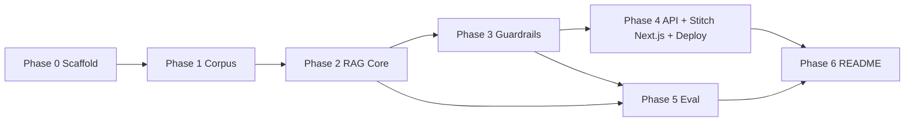

# Mutual Fund FAQ Assistant — Implementation Plan

> **For agentic workers:** REQUIRED SUB-SKILL: Use superpowers:subagent-driven-development (recommended) or superpowers:executing-plans to implement this plan task-by-task. Steps use checkbox (`- [ ]`) syntax for tracking.

**Goal:** Build a facts-only, source-backed RAG FAQ assistant for five HDFC mutual fund schemes with strict refusal of investment advice, exposed as a Next.js UI on Vercel and FastAPI on Railway.

**Architecture:** Offline ingestion builds a Chroma index from **five allowlisted Groww scheme pages**. Online path (Railway FastAPI) classifies intent, refuses unsafe queries, otherwise retrieves scheme-scoped chunks, generates ≤3-sentence answers with exactly one Groww citation and a last-updated footer, then runs a deterministic compliance auditor. Frontend is **Next.js (App Router) + React on Vercel**, ported from **`stitch_hdfc_mutual_fund_faq_assistant/`**.

**Tech Stack:** Python 3.11+, FastAPI (Railway), Next.js App Router + React + Tailwind (Vercel), Stitch UI export, ChromaDB, **Groq** (`llama-3.3-70b-versatile`), local embeddings (`sentence-transformers` / `BAAI/bge-small-en-v1.5`), beautifulsoup4, python-dotenv, pytest

**Spec:** `Docs/Architecture.md` (primary), `Docs/ProblemStatement.md` (requirements), `Docs/superpowers/specs/2026-11-17-vercel-railway-stitch-design.md` (stack/UI)

## Global Constraints

- **Groww corpus only** — index only the five `groww.in/mutual-funds/...` scheme URLs from the problem statement; do not index AMC/AMFI/SEBI, other aggregators, or blogs as knowledge
- Exactly one AMC (HDFC) and exactly these five schemes: mid-cap, small-cap, gold FoF, large-cap, ELSS tax saver (Direct Growth / Direct Plan Growth as named in the problem statement)
- Answers: max 3 sentences (body), exactly one HTTPS citation, footer `Last updated from sources: <date>`
- No investment advice, rankings, performance comparisons, or return calculations
- Do not collect/store/process PAN, Aadhaar, account numbers, OTPs, email, or phone
- Persistent UI disclaimer verbatim: `Facts-only. No investment advice.`
- UI source of truth: `stitch_hdfc_mutual_fund_faq_assistant/` (port to Next.js; remove Simulate View tabs in production)
- Frontend on **Vercel** (`frontend/`); backend on **Railway** (`backend/` FastAPI) — no Streamlit
- LLM via Groq only on Railway (`GROQ_API_KEY`); embeddings local; browser never holds Groq key
- Vercel env: `NEXT_PUBLIC_API_URL` only; no durable chat history database
- Fail closed: uncertain / out-of-corpus / advisory → refuse

## Review Focus

- Advisory phrasing without keywords (“Is this suitable for a 30-year-old?”) must still refuse
- Mixed query (“What is the expense ratio and should I buy it?”) must refuse or answer only the fact without advice — prefer full refuse if advice intent is present
- Citation URL must come from retrieved chunk metadata (Groww scheme URL), never model-invented
- PII-looking input (PAN-like string in chat) must refuse and must not be logged verbatim
- Performance / returns questions must link the scheme’s Groww page only, never compute returns

## Target File Map

```text
RAG-1/
├── Docs/
│   ├── ProblemStatement.md
│   ├── Architecture.md
│   ├── implementation-plan.md
│   └── superpowers/specs/2026-11-17-vercel-railway-stitch-design.md
├── stitch_hdfc_mutual_fund_faq_assistant/   # Stitch design source of truth
│   ├── code.html
│   └── screen.png
├── frontend/                                # Next.js → Vercel
│   ├── app/
│   │   ├── layout.tsx
│   │   ├── page.tsx
│   │   └── globals.css
│   ├── components/                          # ported from Stitch HTML
│   │   ├── AppHeader.tsx
│   │   ├── DisclaimerBanner.tsx
│   │   ├── ChatPanel.tsx
│   │   ├── WelcomeState.tsx
│   │   ├── LoadingState.tsx
│   │   ├── FactualAnswer.tsx
│   │   ├── RefusalMessage.tsx
│   │   ├── Composer.tsx
│   │   └── SchemesSidebar.tsx
│   ├── lib/api.ts                           # POST /api/ask client
│   ├── package.json
│   ├── next.config.ts
│   ├── tailwind.config.ts
│   └── .env.example                         # NEXT_PUBLIC_API_URL
├── backend/                                 # FastAPI → Railway
│   ├── main.py                              # FastAPI app: /health, /api/ask
│   ├── requirements.txt                     # + fastapi, uvicorn
│   ├── .env.example
│   ├── data/
│   ├── corpus_index/                        # gitignored; deploy with service
│   ├── prompts/
│   ├── src/                                 # existing RAG modules (move here)
│   │   ├── config.py
│   │   ├── schemes.py
│   │   ├── ingest/
│   │   └── rag/
│   ├── tests/
│   └── eval/
├── .gitignore
└── README.md
```

**Migration note:** Current top-level `src/`, `data/`, `prompts/`, `tests/` become `backend/` during Phase 4A. Until then, existing RAG tasks may still reference top-level `src/` paths.

---

## Phase 0 — Project Scaffolding

### Task 0: Repo skeleton, deps, config

**Files:**
- Create: `requirements.txt`, `.gitignore`, `.env.example`, `src/__init__.py`, `src/config.py`, `src/schemes.py`, `data/manifest.json`, `prompts/*.txt` (stubs OK until later tasks fill content)

**Interfaces:**
- Produces: `Settings` from `src/config.py`; `SCHEMES` dict from `src/schemes.py`

- [x] **Step 1: Create `requirements.txt`**

```text
fastapi>=0.115.0
uvicorn[standard]>=0.30.0
chromadb>=0.5.0
openai>=1.40.0
sentence-transformers>=3.0.0
pypdf>=4.0.0
beautifulsoup4>=4.12.0
requests>=2.31.0
python-dotenv>=1.0.0
pytest>=8.0.0
httpx>=0.27.0
```

Note: `openai` SDK is used only as the **Groq-compatible client** (`base_url=https://api.groq.com/openai/v1`). Embeddings use `sentence-transformers`, not Groq/OpenAI. **No Streamlit** — UI is Next.js on Vercel; API is FastAPI on Railway (Phase 4).

- [x] **Step 2: Create `.gitignore`**

```text
.env
.venv/
__pycache__/
*.pyc
.pytest_cache/
corpus_index/
data/raw/
data/processed/
*.egg-info/
.DS_Store
```

- [x] **Step 3: Create `.env.example`**

```text
GROQ_API_KEY=gsk_...
GROQ_CHAT_MODEL=llama-3.3-70b-versatile
GROQ_BASE_URL=https://api.groq.com/openai/v1
EMBED_MODEL=BAAI/bge-small-en-v1.5
CHROMA_PATH=corpus_index
SIMILARITY_THRESHOLD=0.35
TOP_K=4
```

- [x] **Step 4: Implement `src/config.py`**

```python
from pathlib import Path
from dataclasses import dataclass
import os
from dotenv import load_dotenv

ROOT = Path(__file__).resolve().parents[1]
load_dotenv(ROOT / ".env")

@dataclass(frozen=True)
class Settings:
    groq_api_key: str
    chat_model: str
    groq_base_url: str
    embed_model: str
    chroma_path: Path
    similarity_threshold: float
    top_k: int
    educational_link: str = "https://www.amfiindia.com/investor-corner/online-centre/onlinecentrelanding"

def get_settings() -> Settings:
    key = os.getenv("GROQ_API_KEY", "")
    if not key:
        raise RuntimeError("GROQ_API_KEY missing. Copy .env.example to .env and set the key.")
    return Settings(
        groq_api_key=key,
        chat_model=os.getenv("GROQ_CHAT_MODEL", "llama-3.3-70b-versatile"),
        groq_base_url=os.getenv("GROQ_BASE_URL", "https://api.groq.com/openai/v1"),
        embed_model=os.getenv("EMBED_MODEL", "BAAI/bge-small-en-v1.5"),
        chroma_path=ROOT / os.getenv("CHROMA_PATH", "corpus_index"),
        similarity_threshold=float(os.getenv("SIMILARITY_THRESHOLD", "0.35")),
        top_k=int(os.getenv("TOP_K", "4")),
    )
```

Helper for chat calls (use in generate/classifier):

```python
from openai import OpenAI

def get_groq_client(settings: Settings) -> OpenAI:
    return OpenAI(api_key=settings.groq_api_key, base_url=settings.groq_base_url)
```

- [x] **Step 5: Implement `src/schemes.py` with the five scheme IDs and aliases**

```python
from typing import Optional

SCHEMES: dict[str, dict] = {
    "hdfc-mid-cap-fund-direct-growth": {
        "name": "HDFC Mid Cap Fund - Direct Growth",
        "aliases": ["mid cap", "midcap", "hdfc mid cap"],
        "category": "mid-cap",
        "groww_url": "https://groww.in/mutual-funds/hdfc-mid-cap-fund-direct-growth",
    },
    "hdfc-small-cap-fund-direct-growth": {
        "name": "HDFC Small Cap Fund - Direct Growth",
        "aliases": ["small cap", "smallcap", "hdfc small cap"],
        "category": "small-cap",
        "groww_url": "https://groww.in/mutual-funds/hdfc-small-cap-fund-direct-growth",
    },
    "hdfc-gold-etf-fund-of-fund-direct-plan-growth": {
        "name": "HDFC Gold ETF Fund of Fund - Direct Plan Growth",
        "aliases": ["gold", "gold etf", "gold fof"],
        "category": "gold-fof",
        "groww_url": "https://groww.in/mutual-funds/hdfc-gold-etf-fund-of-fund-direct-plan-growth",
    },
    "hdfc-large-cap-fund-direct-growth": {
        "name": "HDFC Large Cap Fund - Direct Growth",
        "aliases": ["large cap", "largecap", "hdfc large cap"],
        "category": "large-cap",
        "groww_url": "https://groww.in/mutual-funds/hdfc-large-cap-fund-direct-growth",
    },
    "hdfc-elss-tax-saver-fund-direct-plan-growth": {
        "name": "HDFC ELSS Tax Saver Fund - Direct Plan Growth",
        "aliases": ["elss", "tax saver", "hdfc elss"],
        "category": "elss",
        "groww_url": "https://groww.in/mutual-funds/hdfc-elss-tax-saver-fund-direct-plan-growth",
    },
}

def detect_scheme_id(query: str) -> Optional[str]:
    q = query.lower()
    for scheme_id, meta in SCHEMES.items():
        if meta["name"].lower() in q:
            return scheme_id
        for alias in meta["aliases"]:
            if alias in q:
                return scheme_id
    return None
```

- [x] **Step 6: Create empty package inits and stub `data/manifest.json`**

```json
{
  "amc": "HDFC",
  "documents": []
}
```

- [ ] **Step 7: Commit** (files staged; blocked — set `user.name` / `user.email`, then commit)

```bash
git add requirements.txt .gitignore .env.example src data/manifest.json
git commit -m "chore: scaffold project config, schemes, and dependencies"
```

---

## Phase 1 — Corpus Bootstrap

### Task 1: Manifest of Groww scheme sources

**Files:**
- Modify: `data/manifest.json`, `src/schemes.py` (`groww_url` fields — already set in Task 0)
- Create: `tests/test_manifest.py`

**Interfaces:**
- Produces: `manifest.json` entries with `scheme_id`, `doc_type=groww_scheme_page`, `source_url` (Groww), `as_of_date`, `local_name`

- [ ] **Step 1: Fill `data/manifest.json` with exactly the five Groww URLs**

Do **not** add hdfcfund.com, AMFI, SEBI, Moneycontrol, or other hosts.

```json
{
  "amc": "HDFC",
  "documents": [
    {
      "scheme_id": "hdfc-mid-cap-fund-direct-growth",
      "scheme_name": "HDFC Mid Cap Fund - Direct Growth",
      "doc_type": "groww_scheme_page",
      "source_url": "https://groww.in/mutual-funds/hdfc-mid-cap-fund-direct-growth",
      "as_of_date": "2025-11-17",
      "local_name": "hdfc-mid-cap-fund-direct-growth.html"
    },
    {
      "scheme_id": "hdfc-small-cap-fund-direct-growth",
      "scheme_name": "HDFC Small Cap Fund - Direct Growth",
      "doc_type": "groww_scheme_page",
      "source_url": "https://groww.in/mutual-funds/hdfc-small-cap-fund-direct-growth",
      "as_of_date": "2025-11-17",
      "local_name": "hdfc-small-cap-fund-direct-growth.html"
    },
    {
      "scheme_id": "hdfc-gold-etf-fund-of-fund-direct-plan-growth",
      "scheme_name": "HDFC Gold ETF Fund of Fund - Direct Plan Growth",
      "doc_type": "groww_scheme_page",
      "source_url": "https://groww.in/mutual-funds/hdfc-gold-etf-fund-of-fund-direct-plan-growth",
      "as_of_date": "2025-11-17",
      "local_name": "hdfc-gold-etf-fund-of-fund-direct-plan-growth.html"
    },
    {
      "scheme_id": "hdfc-large-cap-fund-direct-growth",
      "scheme_name": "HDFC Large Cap Fund - Direct Growth",
      "doc_type": "groww_scheme_page",
      "source_url": "https://groww.in/mutual-funds/hdfc-large-cap-fund-direct-growth",
      "as_of_date": "2025-11-17",
      "local_name": "hdfc-large-cap-fund-direct-growth.html"
    },
    {
      "scheme_id": "hdfc-elss-tax-saver-fund-direct-plan-growth",
      "scheme_name": "HDFC ELSS Tax Saver Fund - Direct Plan Growth",
      "doc_type": "groww_scheme_page",
      "source_url": "https://groww.in/mutual-funds/hdfc-elss-tax-saver-fund-direct-plan-growth",
      "as_of_date": "2025-11-17",
      "local_name": "hdfc-elss-tax-saver-fund-direct-plan-growth.html"
    }
  ]
}
```

- [ ] **Step 2: Write test that manifest is Groww-only and matches the five schemes**

```python
import json
from pathlib import Path
from urllib.parse import urlparse

ALLOWED_HOST = "groww.in"
DISALLOWED = ("hdfcfund.com", "amfiindia.com", "sebi.gov.in", "moneycontrol.com", "valueresearchonline.com")
REQUIRED_PATHS = {
    "/mutual-funds/hdfc-mid-cap-fund-direct-growth",
    "/mutual-funds/hdfc-small-cap-fund-direct-growth",
    "/mutual-funds/hdfc-gold-etf-fund-of-fund-direct-plan-growth",
    "/mutual-funds/hdfc-large-cap-fund-direct-growth",
    "/mutual-funds/hdfc-elss-tax-saver-fund-direct-plan-growth",
}

def test_manifest_is_groww_scheme_pages_only():
    manifest = json.loads(Path("data/manifest.json").read_text(encoding="utf-8"))
    assert len(manifest["documents"]) == 5
    paths = set()
    for doc in manifest["documents"]:
        parsed = urlparse(doc["source_url"])
        host = parsed.netloc.lower().removeprefix("www.")
        assert host == ALLOWED_HOST
        assert not any(bad in host for bad in DISALLOWED)
        assert doc["doc_type"] == "groww_scheme_page"
        assert doc["scheme_id"]
        paths.add(parsed.path.rstrip("/"))
    assert paths == REQUIRED_PATHS
```

- [ ] **Step 3: Run test**

Run: `pytest tests/test_manifest.py -v`  
Expected: PASS for Groww-only manifest; FAIL if non-Groww hosts appear

- [ ] **Step 4: Confirm each `groww_url` in `src/schemes.py` matches the corresponding manifest `source_url`**

- [ ] **Step 5: Commit**

```bash
git add data/manifest.json src/schemes.py tests/test_manifest.py
git commit -m "feat: add Groww-only corpus manifest for five HDFC schemes"
```

### Task 2: Fetch + clean pipeline

**Files:**
- Create: `src/ingest/fetch_sources.py`, `src/ingest/clean.py`, `tests/test_clean.py`, `data/fixtures/sample_groww_page.html`

**Interfaces:**
- Produces: `fetch_all(manifest_path: Path, raw_dir: Path) -> list[Path]`
- Produces: `extract_text(path: Path) -> str` and `normalize_text(text: str) -> str`

- [ ] **Step 1: Write failing clean tests**

```python
from src.ingest.clean import normalize_text

def test_normalize_collapses_whitespace_and_keeps_ratios():
    raw = "Expense Ratio:\n\n  0.75%   \nExit Load:\t1%"
    out = normalize_text(raw)
    assert "Expense Ratio: 0.75%" in out.replace("  ", " ")
    assert "Exit Load: 1%" in out
```

- [ ] **Step 2: Implement `normalize_text` and PDF/HTML extractors in `clean.py`**

```python
import re
from pathlib import Path
from pypdf import PdfReader
from bs4 import BeautifulSoup

def normalize_text(text: str) -> str:
    text = text.replace("\xa0", " ")
    text = re.sub(r"[ \t]+", " ", text)
    text = re.sub(r"\n{3,}", "\n\n", text)
    return text.strip()

def extract_text(path: Path) -> str:
    if path.suffix.lower() == ".pdf":
        reader = PdfReader(str(path))
        parts = [page.extract_text() or "" for page in reader.pages]
        return normalize_text("\n".join(parts))
    if path.suffix.lower() in {".html", ".htm"}:
        soup = BeautifulSoup(path.read_text(encoding="utf-8", errors="ignore"), "html.parser")
        for tag in soup(["script", "style", "noscript"]):
            tag.decompose()
        return normalize_text(soup.get_text("\n"))
    return normalize_text(path.read_text(encoding="utf-8", errors="ignore"))
```

- [ ] **Step 3: Implement `fetch_sources.py` to download each Groww HTML URL into `data/raw/` using `requests` (set a normal browser User-Agent), skipping download if file exists and `--force` not set; clean with BeautifulSoup (drop nav/script); write text to `data/processed/{stem}.txt`**

```python
def fetch_all(manifest_path: Path, raw_dir: Path, processed_dir: Path, force: bool = False) -> list[Path]:
    ...
```

Do not follow or index off-domain links from the Groww page.

- [ ] **Step 4: Run**

Run: `pytest tests/test_clean.py -v`  
Then: `python -m src.ingest.fetch_sources` (add `if __name__ == "__main__"` CLI)  
Expected: files appear under `data/raw` and `data/processed`

- [ ] **Step 5: Commit**

```bash
git add src/ingest/fetch_sources.py src/ingest/clean.py tests/test_clean.py
git commit -m "feat: fetch and clean Groww scheme pages"
```

### Task 3: Chunking with metadata

**Files:**
- Create: `src/ingest/chunk.py`, `tests/test_chunk.py`
- Input shape (from `data/processed/*.txt` after Task 2 clean): one short fact sheet per scheme (~690–720 chars), **not** raw Groww HTML

**Observed processed layout (all five schemes):**

```text
Scheme
<name>
Fund House
HDFC Mutual Fund
Category
<Equity|Commodities> / <sub> / Direct
Investment Objective
<one sentence>
Expense Ratio
Expense ratio is X%. Base expense ratio is Y%.
Exit Load
<Nil | Exit load of …>
Minimum SIP
Minimum SIP amount is Rs N.
Minimum Lumpsum
Minimum lumpsum amount is Rs N.
Benchmark
Benchmark is <index>.
Riskometer
<…>
Lock-in
Lock-in period is <None | N year(s)>.
Stamp Duty
Stamp duty is 0.005% (from July 1st, 2020).
NAV
NAV is <value> as of <dd-Mon-yyyy>.
```

**Chunking strategy (aligned to that corpus):**

1. **Section-first, not blind split** — each canonical header line is its own section; most bodies are 1–2 lines, so expect ~12–14 chunks per scheme (one per section) unless a body exceeds `max_chars`.
2. **Exact header match only** — header regex must match the **entire** line (no `\b.*$` suffix). Loose matching turns exit-load *values* (“Exit load of 1% if redeemed…”) into fake headers.
3. **Canonical headers** (case-insensitive, exact line):
   `scheme` | `fund house` | `category` | `investment objective` | `expense ratio` | `exit load` | `minimum sip` | `minimum lumpsum` | `benchmark` | `riskometer` | `lock-in` | `stamp duty` | `nav`
4. **Fixed-size fallback** — only inside an oversized section: `max_chars=600`, `overlap=80`; guard `overlap < max_chars` so the splitter cannot loop.
5. **Scheme identity in text** — prefix embedded chunk text with `"{scheme_name}. "` when missing, so near-identical lines (“Expense ratio is 1.0%.”) across schemes do not collide in vector space.
6. **Never merge schemes** — one `scheme_id` per call; `chunk_id` = `{scheme_id}-{doc_type}-{index}`; `section` = matched header (lowercased) or `"general"` for preamble.

**Do not index from raw HTML chrome.** Chunk only cleaned processed text (no peer-compare blocks, return calculators, historic exit-load tables, or Groww nav menus).

**Interfaces:**
- Produces: `Chunk` dataclass; `chunk_document(text, meta) -> list[Chunk]`

- [ ] **Step 1: Write failing tests**

```python
from src.ingest.chunk import chunk_document

META = {
    "scheme_id": "hdfc-large-cap-fund-direct-growth",
    "scheme_name": "HDFC Large Cap Fund - Direct Growth",
    "amc": "HDFC",
    "doc_type": "groww_scheme_page",
    "source_url": "https://groww.in/mutual-funds/hdfc-large-cap-fund-direct-growth",
    "as_of_date": "2026-11-16",
}

# Realistic processed-style fixture (mirrors data/processed/*.txt)
SAMPLE = """Scheme
HDFC Large Cap Fund Direct Growth

Expense Ratio
Expense ratio is 1.0%. Base expense ratio is 0.82%.

Exit Load
Exit load of 1% if redeemed within 1 year

Minimum SIP
Minimum SIP amount is Rs 100.
"""

def test_chunks_carry_required_metadata_and_stay_single_scheme():
    chunks = chunk_document(SAMPLE, META)
    assert len(chunks) >= 1
    for c in chunks:
        assert c.scheme_id == META["scheme_id"]
        assert c.source_url.startswith("https://")
        assert c.as_of_date == "2026-11-16"
        assert "groww.in" in c.source_url
        assert c.text.strip()

def test_exit_load_value_is_not_a_section_header():
    text = (
        "Exit Load\nExit load of 1% if redeemed within 1 year.\n"
        "Exit load of 1% if redeemed within 18 months\n"
        "Minimum SIP\nMinimum SIP amount is Rs 100."
    )
    sections = {c.section for c in chunk_document(text, META)}
    assert "exit load" in sections
    assert "minimum sip" in sections
    assert not any("18 months" in s for s in sections)
```

- [ ] **Step 2: Implement section-aware chunking with exact headers + fixed-size fallback**

```python
from dataclasses import dataclass
import re

SECTION_HEADERS = re.compile(
    r"(?im)^(expense ratio|exit load|minimum sip|minimum lumpsum|riskometer|"
    r"benchmark|lock-in|investment objective|scheme|fund house|category|"
    r"stamp duty|nav)$"
)

@dataclass
class Chunk:
    chunk_id: str
    scheme_id: str
    scheme_name: str
    amc: str
    doc_type: str
    source_url: str
    as_of_date: str
    section: str
    text: str

def chunk_document(text: str, meta: dict, max_chars: int = 600, overlap: int = 80) -> list[Chunk]:
    ...
```

Rules: never merge two different `scheme_id`s; set `section` from exact header match or `"general"`; `chunk_id` = `{scheme_id}-{doc_type}-{index}`; prefix `scheme_name` into `text` when absent.

- [ ] **Step 3: Run** `pytest tests/test_chunk.py -v` — Expected: PASS

- [ ] **Step 4: Commit**

```bash
git add src/ingest/chunk.py tests/test_chunk.py
git commit -m "feat: add scheme-aware document chunking"
```

### Task 4: Embed + index into Chroma

**Files:**
- Create: `src/ingest/index.py`, `tests/test_index.py` (use fixture texts; may mock embeddings in CI)

**Interfaces:**
- Produces: `build_index(processed_dir, manifest_path, settings) -> int` (chunk count)
- Produces: Chroma collection name `mf_faq`

- [ ] **Step 1: Implement indexer using local `sentence-transformers` embeddings + Chroma PersistentClient**

Load `SentenceTransformer(settings.embed_model)` once; embed chunk texts in batches; upsert into Chroma. Store each chunk’s `text` as document and all metadata fields as Chroma metadata (string values only). Do **not** call Groq for embeddings.

```python
def build_index(...) -> int:
    """Chunk all processed docs from manifest and upsert into Chroma. Returns chunk count."""
```

- [ ] **Step 2: Add CLI** `python -m src.ingest.index` that prints `Indexed N chunks`

- [ ] **Step 3: Smoke-test locally** (requires `.env`): run fetch → index; open Chroma path and confirm count > 0

- [ ] **Step 4: Commit**

```bash
git add src/ingest/index.py
git commit -m "feat: build Chroma index from Groww scheme pages"
```

**Phase 1 exit criteria:** Groww-only manifest; processed HTML texts on disk; Chroma index contains chunks for all five schemes with Groww `source_url` + `as_of_date`.

---

## Phase 2 — RAG Core

### Task 5: Response formatter

**Files:**
- Create: `src/rag/format_response.py`, `tests/test_format_response.py`

**Interfaces:**
- Produces: `format_factual_answer(body: str, source_url: str, as_of_date: str) -> str`

- [ ] **Step 1: Write failing tests**

```python
from src.rag.format_response import format_factual_answer, truncate_to_three_sentences

def test_truncate_to_three_sentences():
    body = "One. Two. Three. Four."
    assert truncate_to_three_sentences(body) == "One. Two. Three."

def test_format_includes_single_link_and_footer():
    out = format_factual_answer(
        "The expense ratio is 0.80%.",
        "https://groww.in/mutual-funds/hdfc-large-cap-fund-direct-growth",
        "2025-11-17",
    )
    assert out.count("https://") == 1
    assert "groww.in" in out
    assert "Last updated from sources: 2025-11-17" in out
```

- [ ] **Step 2: Implement**

```python
import re

def truncate_to_three_sentences(text: str) -> str:
    parts = re.split(r"(?<=[.!?])\s+", text.strip())
    parts = [p for p in parts if p]
    return " ".join(parts[:3]).strip()

def format_factual_answer(body: str, source_url: str, as_of_date: str) -> str:
    body = truncate_to_three_sentences(body)
    return f"{body}\nSource: {source_url}\nLast updated from sources: {as_of_date}"
```

- [ ] **Step 3: Run** `pytest tests/test_format_response.py -v` — PASS

- [ ] **Step 4: Commit**

```bash
git add src/rag/format_response.py tests/test_format_response.py
git commit -m "feat: format answers with citation and last-updated footer"
```

### Task 6: Compliance auditor

**Files:**
- Create: `src/rag/audit.py`, `tests/test_audit.py`

**Interfaces:**
- Produces: `AuditResult(ok: bool, reasons: list[str])`; `audit_response(text: str) -> AuditResult`

- [ ] **Step 1: Write failing tests for sentence limit, single citation, footer, advice blocklist, PAN-like patterns**

```python
from src.rag.audit import audit_response

GOOD = (
    "The expense ratio for the Direct plan is 0.80%. Exit load may apply as per the scheme page.\n"
    "Source: https://groww.in/mutual-funds/hdfc-large-cap-fund-direct-growth\n"
    "Last updated from sources: 2025-11-17"
)

def test_good_response_passes():
    assert audit_response(GOOD).ok

def test_advice_phrase_fails():
    bad = GOOD.replace("0.80%", "0.80%. I recommend buying this fund")
    assert not audit_response(bad).ok

def test_missing_footer_fails():
    bad = "The expense ratio is 0.80%.\nSource: https://groww.in/mutual-funds/hdfc-large-cap-fund-direct-growth"
    assert not audit_response(bad).ok
```

- [ ] **Step 2: Implement auditor**

Checks:
1. Body (before `Source:`) ≤ 3 sentences  
2. Exactly one `https://` URL  
3. Footer regex `Last updated from sources: \d{4}-\d{2}-\d{2}`  
4. Blocklist: `i recommend`, `you should invest`, `better than`, `guaranteed returns`, `buy this`, `sell this`  
5. PAN-like `[A-Z]{5}[0-9]{4}[A-Z]` must not appear  

- [ ] **Step 3: Run** `pytest tests/test_audit.py -v` — PASS

- [ ] **Step 4: Commit**

```bash
git add src/rag/audit.py tests/test_audit.py
git commit -m "feat: add deterministic compliance auditor for answers"
```

### Task 7: Retriever

**Files:**
- Create: `src/rag/retrieve.py`, `tests/test_retrieve.py`
- Uses: `corpus_index` collection `mf_faq` (cosine space); `src.schemes.detect_scheme_id`

**Corpus facts (from `data/processed` + live Chroma probe):**

| Fact | Observation |
|------|-------------|
| Size | 65 chunks = 5 schemes × 13 exact sections |
| Chunk shape | One short fact per section (~60–210 chars), already prefixed with scheme name |
| Sections | `scheme`, `fund house`, `category`, `investment objective`, `expense ratio`, `exit load`, `minimum sip`, `minimum lumpsum`, `benchmark`, `riskometer`, `lock-in`, `stamp duty`, `nav` |
| Cross-scheme risk | Same section text is near-duplicate across funds (“Expense ratio is X%”). Bare query `expense ratio` ranks **ELSS** first, not a user-chosen fund |
| Unfiltered named query | Often ranks the right scheme #1, but still returns other schemes’ same section |
| Scheme filter | Removes other funds; still returns unrelated sections of the same scheme (e.g. riskometer next to NAV) |
| Scheme **+ section** filter | Returns the single correct fact as #0 (probe: expense/exit/SIP/lock-in/objective/NAV/benchmark all hit) |
| Score scale | Collection `hnsw:space=cosine`; Chroma `distances` are **cosine distance**. Similarity = `1 - distance`. Good hits ≈ **0.75–0.91** sim (dist ≈ 0.09–0.25) |

**Best retrieval strategy (required for Task 7):**

```text
1. detect_scheme_id(query) via SCHEMES aliases
2. detect_section(query) via keyword → canonical section map
3. Embed query with same local EMBED_MODEL as indexing (no Groq)
4. Build Chroma where:
     - scheme_id only          if scheme known, section unknown
     - section only            if section known, scheme unknown (multi-scheme → orchestrator should refuse/clarify)
     - $and [scheme_id, section] if both known  ← preferred path
     - no filter               only as last resort (expect noisy neighbors)
5. query n_results = top_k (default 3; when both filters set, 2 is enough)
6. Convert distance → score = 1 - distance (document as cosine similarity)
7. Keep chunks with score >= similarity_threshold; sort by score desc
8. If filtered query returns 0 kept rows and a section filter was used:
     retry once with scheme_id-only (widen), then re-threshold
9. If still empty → insufficient evidence (orchestrator refuses)
```

**Section hint map** (match first hit on lowered query; prefer longer/more specific needles first):

| Needle(s) in query | `section` metadata |
|--------------------|--------------------|
| `expense ratio` / `expense` | `expense ratio` |
| `exit load` | `exit load` |
| `minimum sip` / `min sip` / `sip` | `minimum sip` |
| `lumpsum` / `lump sum` | `minimum lumpsum` |
| `lock-in` / `lock in` / `lockin` | `lock-in` |
| `benchmark` | `benchmark` |
| `riskometer` / `risk` | `riskometer` |
| `investment objective` / `objective` | `investment objective` |
| `nav` | `nav` |
| `stamp duty` | `stamp duty` |
| `category` | `category` |

**Threshold guidance:** default `SIMILARITY_THRESHOLD=0.35` is too loose for this dense 65-chunk corpus (weak neighbors still clear 0.35). Prefer **`0.55`** as the floor for “usable evidence”; probe’s correct #0 hits were ≥ ~0.75. Keep env-overridable. `TOP_K=3` (or 4 max).

**Policy for orchestrator (document here; enforce in Task 11):** fact questions without a resolvable `scheme_id` → refuse/ask which of the five schemes (do not answer from mixed-scheme top-k). Citation URL always comes from a kept chunk’s `source_url` metadata.

**Interfaces:**
- Produces: `RetrievedChunk`; `detect_section(query) -> str | None`; `retrieve(query, settings, scheme_id: str | None = None) -> list[RetrievedChunk]`

```python
@dataclass
class RetrievedChunk:
    text: str
    source_url: str
    as_of_date: str
    scheme_id: str
    section: str
    score: float  # cosine similarity in [0, 1] = 1 - chroma_distance
```

- [ ] **Step 1: Write failing unit tests for `detect_section` + filter construction (mock Chroma)**

```python
from src.rag.retrieve import detect_section

def test_detect_section_expense_and_lockin():
    assert detect_section("What is the expense ratio?") == "expense ratio"
    assert detect_section("ELSS lock-in period") == "lock-in"
    assert detect_section("minimum SIP HDFC Small Cap") == "minimum sip"
```

- [ ] **Step 2: Implement retrieval against collection `mf_faq`** using the strategy above (same `EMBED_MODEL` as index; cosine similarity score; scheme/section `where`; threshold + optional widen retry).

- [ ] **Step 3: Integration smoke test (skip if no local Chroma index)**

```python
from pathlib import Path
import pytest
from src.rag.retrieve import retrieve
from src.config import get_settings

@pytest.mark.skipif(not Path("corpus_index").exists(), reason="needs built Chroma index")
def test_retrieve_large_cap_expense_ratio():
    chunks = retrieve(
        "What is the expense ratio of HDFC Large Cap Fund?",
        get_settings(),
        scheme_id="hdfc-large-cap-fund-direct-growth",
    )
    assert chunks
    assert chunks[0].section == "expense ratio"
    assert chunks[0].scheme_id == "hdfc-large-cap-fund-direct-growth"
    assert chunks[0].source_url.startswith("https://groww.in/")
    assert chunks[0].score >= 0.55
```

- [ ] **Step 4: Commit**

```bash
git add src/rag/retrieve.py tests/test_retrieve.py
git commit -m "feat: retrieve scheme-scoped chunks from Chroma"
```

### Task 8: Generator + prompts

**Files:**
- Create: `src/rag/generate.py`, `prompts/system_factual.txt`
- Modify: none required beyond prompts

**Interfaces:**
- Produces: `generate_factual_answer(query: str, chunks: list[RetrievedChunk], settings) -> str` (raw model body without requiring model to invent URL — caller passes top chunk metadata into formatter)

- [ ] **Step 1: Write `prompts/system_factual.txt`**

```text
You are a facts-only mutual fund FAQ assistant.
Answer ONLY using the provided context.
Use at most 3 sentences.
Do not give investment advice, comparisons, rankings, or return predictions.
If context is insufficient, say you do not have that fact in the corpus.
Do not invent numbers or URLs.
```

- [ ] **Step 2: Implement `generate.py` with Groq chat completions via `get_groq_client(settings)`; pass numbered context blocks; return plain body text only**

```python
client = get_groq_client(settings)
response = client.chat.completions.create(
    model=settings.chat_model,  # llama-3.3-70b-versatile
    messages=[
        {"role": "system", "content": system_prompt},
        {"role": "user", "content": user_payload},
    ],
    temperature=0.0,
)
```

- [ ] **Step 3: Wire helper used by orchestrator:**

```python
def answer_from_chunks(query, chunks, settings) -> str:
    body = generate_factual_answer(query, chunks, settings)
    top = chunks[0]
    return format_factual_answer(body, top.source_url, top.as_of_date)
```

- [ ] **Step 4: Commit**

```bash
git add src/rag/generate.py prompts/system_factual.txt
git commit -m "feat: add constrained factual answer generation"
```

**Phase 2 exit criteria:** Given a factual query and non-empty chunks, system returns audited, formatted answer with one citation + date footer.

---

## Phase 3 — Guardrails

### Task 9: Intent classifier

**Files:**
- Create: `src/rag/classify.py`, `prompts/classifier.txt`, `tests/test_classify.py`

**Interfaces:**
- Produces: `Intent` enum; `classify(query: str, settings | None = None) -> Intent`

Intent values: `FACTUAL_SCHEME`, `FACTUAL_PROCESS`, `PERFORMANCE`, `ADVISORY`, `COMPARATIVE`, `PII_SENSITIVE`, `OUT_OF_CORPUS`, `UNCLEAR`

- [ ] **Step 1: Write rule-first unit tests (no API required)**

```python
from src.rag.classify import classify, Intent

def test_advisory_keyword():
    assert classify("Should I invest in HDFC Mid Cap?") == Intent.ADVISORY

def test_comparative():
    assert classify("Which is better, large cap or mid cap?") == Intent.COMPARATIVE

def test_performance():
    assert classify("What is the 5 year return of HDFC Large Cap?") == Intent.PERFORMANCE

def test_pii():
    assert classify("My PAN is ABCDE1234F, show my holdings") == Intent.PII_SENSITIVE

def test_factual_expense():
    assert classify("What is the expense ratio of HDFC Large Cap Fund?") == Intent.FACTUAL_SCHEME
```

- [ ] **Step 2: Implement keyword/regex rules first; optional LLM fallback only if rules return `UNCLEAR` and settings provided**

Prefer false refusals: if both advice and fact cues appear → `ADVISORY`.

- [ ] **Step 3: Run** `pytest tests/test_classify.py -v` — PASS

- [ ] **Step 4: Commit**

```bash
git add src/rag/classify.py prompts/classifier.txt tests/test_classify.py
git commit -m "feat: add fail-closed intent classification"
```

### Task 10: Refusal handler

**Files:**
- Create: `src/rag/refuse.py`, `tests/test_refuse.py`

**Interfaces:**
- Produces: `build_refusal(intent: Intent, scheme_id: str | None, settings: Settings) -> str`

- [ ] **Step 1: Tests**

```python
from src.rag.refuse import build_refusal
from src.rag.classify import Intent
from src.config import Settings
from pathlib import Path

SETTINGS = Settings(
    groq_api_key="x",
    chat_model="llama-3.3-70b-versatile",
    groq_base_url="https://api.groq.com/openai/v1",
    embed_model="BAAI/bge-small-en-v1.5",
    chroma_path=Path("."),
    similarity_threshold=0.35,
    top_k=4,
)

def test_advisory_refusal_has_edu_link_and_no_advice():
    text = build_refusal(Intent.ADVISORY, None, SETTINGS)
    assert "investment advice" in text.lower() or "cannot" in text.lower()
    assert SETTINGS.educational_link in text
    assert "i recommend" not in text.lower()

def test_performance_points_to_groww_page_when_scheme_known():
    text = build_refusal(Intent.PERFORMANCE, "hdfc-large-cap-fund-direct-growth", SETTINGS)
    assert "groww.in/mutual-funds/hdfc-large-cap-fund-direct-growth" in text
```

- [ ] **Step 2: Implement templates** matching Architecture §9 (polite; what we can answer; optional AMFI/SEBI edu link for advice refusals only). For `PERFORMANCE`, include scheme `groww_url` when known.

- [ ] **Step 3: Commit**

```bash
git add src/rag/refuse.py tests/test_refuse.py
git commit -m "feat: add polite refusal templates with educational links"
```

### Task 11: Orchestrator end-to-end path

**Files:**
- Create: `src/rag/orchestrator.py`, `tests/test_orchestrator.py`

**Interfaces:**
- Produces: `answer_query(query: str, settings: Settings | None = None) -> str`

Flow:
1. If PII pattern in raw query → refuse `PII_SENSITIVE` (do not log raw query)
2. `intent = classify(query)`
3. If intent in refuse set → `build_refusal`
4. If `PERFORMANCE` → refusal + Groww scheme page link
5. Else retrieve → if empty → out-of-corpus refusal
6. `answer_from_chunks` → `audit_response`
7. If audit fails → one stricter regenerate; if still fail → safe refusal

- [ ] **Step 1: Unit-test orchestrator with monkeypatched classify/retrieve/generate**

```python
def test_orchestrator_refuses_advisory(monkeypatch):
    from src.rag import orchestrator
    from src.rag.classify import Intent
    monkeypatch.setattr(orchestrator, "classify", lambda q, s=None: Intent.ADVISORY)
    monkeypatch.setattr(orchestrator, "get_settings", lambda: SETTINGS)
    out = orchestrator.answer_query("Should I buy this?")
    assert "https://www.amfiindia.com" in out
```

- [ ] **Step 2: Implement `answer_query`**

- [ ] **Step 3: Run** `pytest tests/test_orchestrator.py tests/test_classify.py tests/test_audit.py -v`

- [ ] **Step 4: Commit**

```bash
git add src/rag/orchestrator.py tests/test_orchestrator.py
git commit -m "feat: wire classify-retrieve-generate-audit orchestrator"
```

**Phase 3 exit criteria:** Advisory/comparative/PII/performance paths refuse correctly; factual path still works; auditor enforced.

---

## Phase 4 — API + Stitch Frontend + Deploy

> **UI source of truth:** `stitch_hdfc_mutual_fund_faq_assistant/code.html` + `screen.png`.  
> Port visuals/components into Next.js; **do not** ship the Stitch “Simulate View” tab bar — production states come from the API.

### Task 12: Monorepo split + FastAPI on Railway shape

**Files:**
- Create/move into: `backend/main.py`, `backend/requirements.txt`, `backend/.env.example`
- Move existing: `src/`, `data/`, `prompts/`, `tests/`, `eval/`, `corpus_index/` → under `backend/` (update imports/paths as needed)
- Remove any Streamlit UI path (`src/ui/app.py` if present); drop `streamlit` from requirements

**Interfaces:**
- `GET /health` → `{ "status": "ok" }`
- `POST /api/ask` body `{ "question": str }` → factual or refusal JSON (see design spec)
- Internally calls `answer_query` / orchestrator; map to structured response (`type`, `answer`, `citation_url` / `educational_url`, etc.)

- [x] **Step 1: Create `backend/` layout and move RAG code; fix imports so tests still pass from `backend/`**
- [x] **Step 2: Add FastAPI + uvicorn; implement `/health` and `/api/ask` with CORS (`CORS_ORIGINS`)**
- [x] **Step 3: Add pytest (or httpx TestClient) covering factual vs refusal JSON shapes**
- [ ] **Step 4: Local run** `uvicorn main:app --reload` from `backend/`; curl `/api/ask` (needs `backend/.env` with `GROQ_API_KEY`)
- [ ] **Step 5: Commit** (when you ask)

### Task 12b: Next.js frontend from Stitch → Vercel

**Files:**
- Create: `frontend/` Next.js App Router app (React + Tailwind + Plus Jakarta Sans)
- Port components from `stitch_hdfc_mutual_fund_faq_assistant/code.html`
- Create: `frontend/lib/api.ts`, `frontend/.env.example` (`NEXT_PUBLIC_API_URL`)

**Interfaces:**
- `askQuestion(question: string)` → calls `${NEXT_PUBLIC_API_URL}/api/ask`
- UI states: `welcome` | `loading` | `factual` | `refusal` (React state, not Simulate tabs)

- [x] **Step 1: Scaffold Next.js in `frontend/` with Tailwind; fonts/colors match Stitch (`#0D7A5F`, slate, Plus Jakarta Sans)**
- [x] **Step 2: Port layout — AppHeader, DisclaimerBanner (`Facts-only. No investment advice.`), ChatPanel, SchemesSidebar, Composer**
- [x] **Step 3: Wire Welcome (3 example chips), Loading, Factual (citation + last updated), Refusal (AMFI link + recovery chips)**
- [x] **Step 4: Remove Simulate View controls; drive states from fetch lifecycle**
- [ ] **Step 5: Manual checklist** (run locally against backend)
  - [ ] Matches Stitch welcome layout (disclaimer + examples + sidebar)
  - [ ] Example chips submit questions
  - [ ] Advisory → refusal UI; factual → source + date
  - [ ] No PII fields; session-only messages; refresh clears chat
- [ ] **Step 6: Commit** (when you ask)

### Task 12c: Deploy Railway (backend) + Vercel (frontend)

**Files:**
- Optional: `backend/Dockerfile` or Railway Nixpacks config; `frontend` Vercel project settings
- Update root `README.md` deploy section (full README in Phase 6)

- [x] **Step 1a: Add deploy config** — `backend/railway.toml`, `backend/Procfile`, `frontend/vercel.json`
- [ ] **Step 1b: Railway — deploy `backend/`; set `GROQ_API_KEY`, chroma/embed vars, `CORS_ORIGINS` (Vercel URL + `http://localhost:3000`); ensure index present**
- [ ] **Step 2: Vercel — Root Directory `frontend`; set `NEXT_PUBLIC_API_URL` to Railway public URL**
- [ ] **Step 3: Smoke test production URL: welcome → example question → factual or refusal**
- [ ] **Step 4: Commit any deploy config** (when you ask)


**Phase 4 exit criteria:** Local + deployed demo works: Stitch-based Next.js UI on Vercel calls Railway `/api/ask`; disclaimer and three examples present; no Streamlit.

---

## Phase 5 — Evaluation

### Task 13: Golden set + eval runner

**Files:**
- Create: `eval/golden_questions.json`, `eval/run_eval.py`

**Interfaces:**
- Produces: CLI that prints pass/fail summary; exit code ≠ 0 if any required case fails

- [x] **Step 1: Author golden set (≥12 cases)** — `backend/eval/golden_questions.json` (13 cases: 5 factual, process, 2 advisory, comparative, mixed, performance, out-of-corpus, PII)

- [x] **Step 2: Implement `run_eval.py`** — `backend/eval/run_eval.py` calling `answer_query` + `audit_response` / string checks

- [x] **Step 3: Run** `python eval/run_eval.py` — **13/13 passed** (also tightened orchestrator: process-without-scheme refuses; no fake Source when model says not-in-corpus)

- [ ] **Step 4: Commit** (when you ask)

```bash
git add backend/eval backend/src/rag/orchestrator.py backend/tests/test_orchestrator.py
git commit -m "test: add golden FAQ eval suite for compliance and facts"
```

**Phase 5 exit criteria:** Advisory refused 100% in golden set; factual cases pass audit formatting; performance never returns computed returns. ✅

---

## Phase 6 — Documentation & Hand-off

### Task 14: README deliverable

**Files:**
- Create: `README.md`

Must include:
1. Monorepo setup: `backend/` (venv, `.env`, pip, fetch, index, `uvicorn`) and `frontend/` (`npm i`, `npm run dev`, `NEXT_PUBLIC_API_URL`)
2. Deploy: Railway (backend) + Vercel (frontend Root Directory); required env vars
3. UI note: design from `stitch_hdfc_mutual_fund_faq_assistant/`
4. Selected AMC + five schemes
5. Architecture overview (RAG + guardrails; link to `Docs/Architecture.md`)
6. Known limitations (from Architecture §16)
7. Disclaimer snippet: `Facts-only. No investment advice.`

- [ ] **Step 1: Write README**
- [ ] **Step 2: Fresh-machine dry run following README only (local backend + frontend)**
- [ ] **Step 3: Commit**

```bash
git add README.md
git commit -m "docs: add monorepo setup, Vercel/Railway deploy, limitations, disclaimer"
```

---

## Phase Dependency Graph



Phase 5 (eval) can proceed in parallel with Phase 4 frontend work after Phase 3; deploy (12c) needs API (12) ready.

---

## Definition of Done (Project)

- [ ] Index built from Groww scheme URLs only for all five HDFC schemes
- [ ] Factual answers: ≤3 sentences, exactly one Groww citation, last-updated footer
- [ ] Advisory / comparative / PII queries refused with educational link
- [ ] Performance queries → Groww scheme page link only
- [ ] Next.js UI (from Stitch) shows welcome, 3 examples, persistent disclaimer
- [ ] FastAPI on Railway; frontend on Vercel; browser has no Groq key
- [ ] Golden eval passes required cases
- [ ] README complete with monorepo + deploy + disclaimer and limitations
- [ ] No PII storage; secrets not committed

---

## Spec Coverage Checklist

| Requirement | Task(s) |
|-------------|---------|
| Curated Groww corpus (5 HDFC schemes) | 1–4 |
| Facts-only RAG answers | 5–8, 11 |
| Max 3 sentences + one citation + date footer | 5, 6 |
| Refusal of advice / comparisons | 9, 10, 11 |
| Performance → Groww scheme page only | 10, 11 |
| Stitch → Next.js UI + disclaimer + 3 examples | 12b |
| FastAPI `/api/ask` on Railway | 12 |
| Vercel frontend deploy | 12c |
| Privacy (no PII collect/store) | 0, 9, 11, 12b |
| README deliverable | 14 |
| Success / eval criteria | 13 |

---

## Self-Review Notes

- Corpus URLs are the five Groww scheme pages from the problem statement (Task 1 manifest).
- Interfaces use consistent names: `classify`, `retrieve`, `answer_query`, `audit_response`, `format_factual_answer`, `build_refusal`, `detect_scheme_id`, `get_groq_client`; scheme field is `groww_url` (not AMC factsheet).
- LLM provider is **Groq** on **Railway only**; embeddings are **local** (`sentence-transformers`). Do not put Groq keys in Vercel/browser.
- UI is **Stitch → Next.js/React on Vercel**; do not reintroduce Streamlit.
- Review Focus cases are pinned in Tasks 9–11 and 13.
