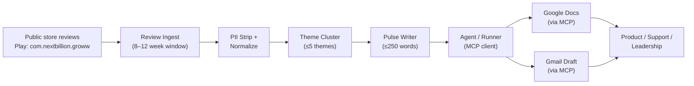
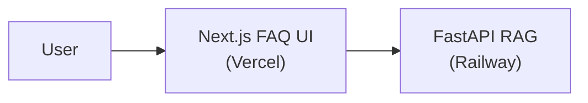
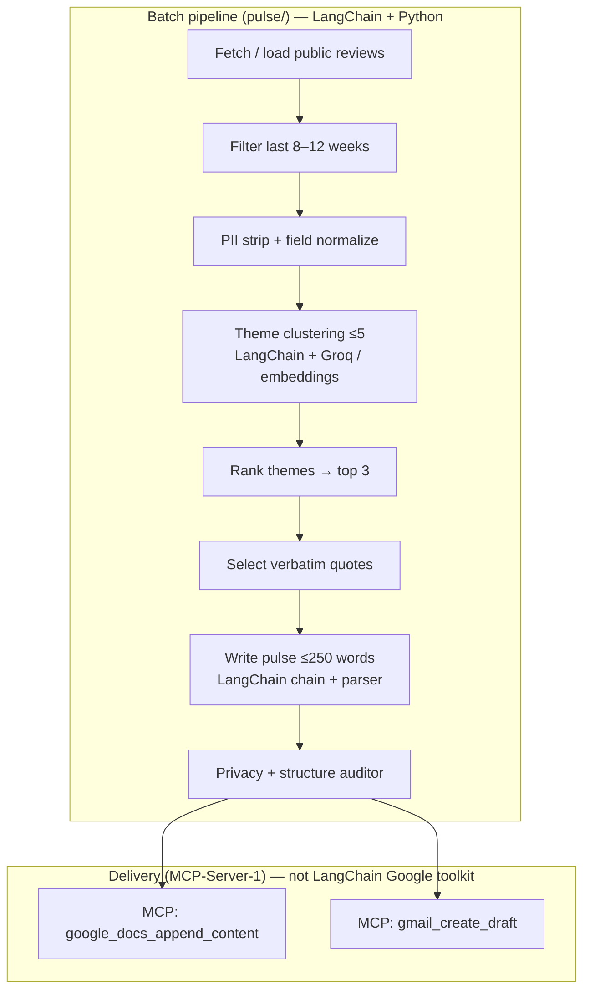
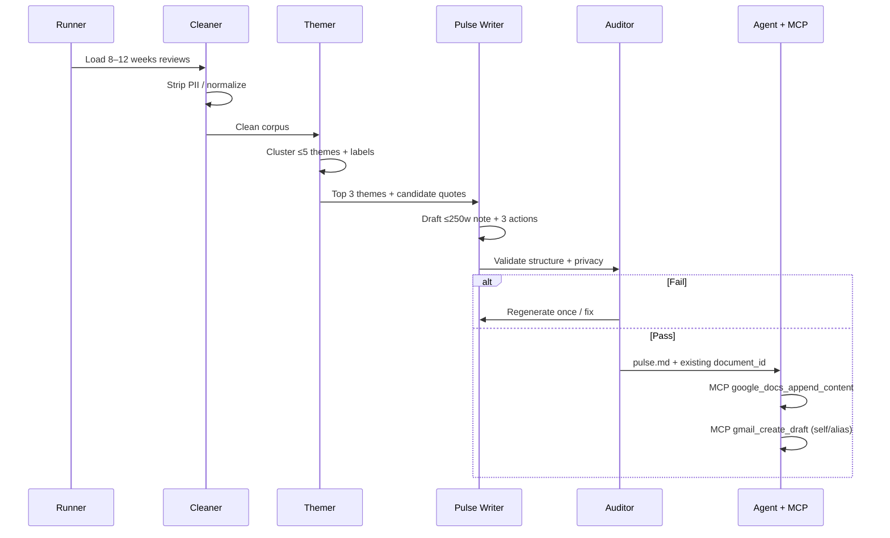
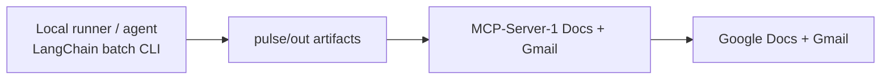
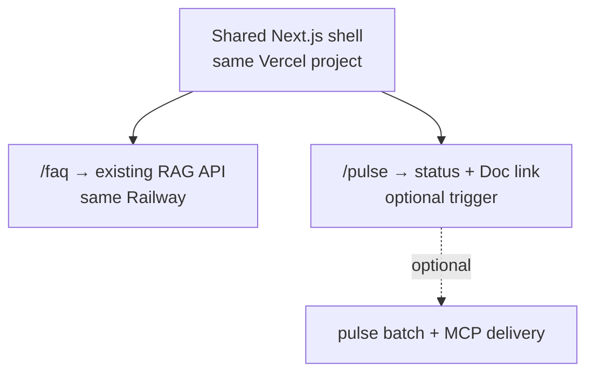

# Architecture: Groww Weekly Review Pulse (MCP Docs + Gmail)

## 1. Purpose

This document defines the system architecture for a **weekly review pulse** for the Groww consumer app. The system turns **public** Play Store (and optionally App Store) reviews into a scannable one-page note—top themes, verbatim quotes, and concrete action ideas—then delivers that note through **Google Docs** and a **Gmail draft** using **MCP** (not bespoke Google OAuth/REST as the primary path).

**Design priorities (in order):**

1. Compliance and privacy (public exports only; no reviewer PII in any artifact)
2. Faithfulness (verbatim quotes; themes and actions grounded in real reviews)
3. MCP-first delivery (Docs + Gmail via [FallenOne1701/MCP-Server-1](https://github.com/FallenOne1701/MCP-Server-1))
4. Separation from the FAQ track until an explicit combined-demo merge
5. Simplicity (batch pipeline + agent delivery; no heavy product surface in v1)
6. LangChain for batch LLM orchestration; MCP for Google delivery (do not replace MCP with LangChain Google tools)

**Sibling track:** Mutual Fund FAQ Assistant lives under `Docs-FAQ/` with `frontend/` + `backend/` on Vercel/Railway. This pulse track is designed **beside** that stack and composed later without replacing those deployments.

---

## 2. Design Principles

| Principle | Implication |
|-----------|-------------|
| Public data only | No store logins; no ToS-violating scrapers; use public listing/export paths |
| Themes over firehose | Cap clustering at **5** themes; written pulse highlights **top 3** |
| Quotes are sacred | Never invent or paraphrase into “fake” quotes; strip PII from snippets |
| Actions must earn their place | Exactly **3** action ideas, each tied to an observed theme |
| MCP-first delivery | Docs append + Gmail draft go through MCP-Server-1 tools |
| Fail closed on privacy | Drop usernames, emails, device IDs before theme/pulse/delivery |
| FAQ isolation | Do not mix review text into the FAQ Chroma corpus or Groq FAQ prompts |

---

## 3. High-Level System Context



**FAQ (unchanged in this track):**



Pulse does **not** depend on Railway/Vercel for Docs/Gmail. Those hosts stay FAQ-only until the combined-demo merge.

---

## 4. Scope Boundary

### 4.1 In Scope

- Product: **Groww** Android app on Play Store (`com.nextbillion.groww`)
  - Listing: https://play.google.com/store/apps/details?id=com.nextbillion.groww&hl=en_IN
- Optional: App Store reviews **only if** a compliant public export is available
- Import ~**8–12 weeks** of reviews (rating, title, text, date, store, as provided)
- Cluster into **≤5** themes; write pulse with **top 3** themes, **3** quotes, **3** actions
- Publish the pulse into a Google Doc via MCP (`google_docs_append_content` on a pre-created Doc)
- Create a Gmail **draft** (self or alias) with the note or Doc link via MCP (`gmail_create_draft`)
- Local/offline artifacts: cleaned review JSON, theme map, pulse markdown snapshot (no PII)
- Docs under `Docs-MCP-&-RAG/`; code under a dedicated `pulse/` area

### 4.2 Out of Scope (this track)

- Folding pulse into FAQ RAG retrieval or Chroma index
- Custom Google OAuth client + REST as the **primary** Docs/Gmail path
- Live scraping behind Google/Apple logins; mass unauthorized automation
- Storing or displaying reviewer names, emails, device IDs, or account handles
- Full product analytics product (dashboards, realtime streams, ticketing sync)
- Replacing or redeploying FAQ Vercel/Railway projects as new apps (update-in-place only at merge)
- Investment advice derived from reviews (pulse is product-feedback oriented)

---

## 5. Recommended Tech Stack

| Layer | Choice | Rationale |
|-------|--------|-----------|
| Review source (Play) | Public Play listing fetch via a known public-data helper (e.g. `google-play-scraper`-style **public** endpoints) **or** a checked-in CSV/JSON export refreshed manually | Matches “public exports only”; document exact method in README |
| Review source (iOS) | Optional later; same public-export rule | Don’t block Play-first MVP |
| Language | Python 3.11+ | Aligns with existing `backend/` skills and Groq usage |
| Batch orchestration | **LangChain** (LCEL chains / small Runnable pipeline) | Fits theme labeling, structured pulse generation, prompt templates, and output parsing without owning Docs/Gmail auth |
| Pulse / theme LLM | **Groq** via LangChain chat model (`llama-3.3-70b-versatile` or current project default) | Already in monorepo; LangChain `ChatGroq` (or OpenAI-compatible wrapper) keeps prompts/chains portable |
| Optional embeddings | LangChain embeddings wrapper over local `sentence-transformers` (reuse FAQ model if useful) | Theme clustering / similarity for quote candidates |
| Structured output | LangChain parsers / `with_structured_output` for themes + pulse JSON | Enforces ≤5 themes, 3 quotes, 3 actions before markdown render |
| Scheduler | **Not required for v1** — on-demand CLI | “Weekly” is the product cadence; a cron is optional polish, not a deliverable gate (see §14.1) |
| Delivery orchestration | CLI produces artifacts → **Cursor/agent MCP calls** for Docs & Gmail | MCP-first delivery; LangChain does **not** call Google APIs as the primary path |
| Docs / Gmail | **[MCP-Server-1](https://github.com/FallenOne1701/MCP-Server-1)** (Google Workspace MCP) | Provides `gmail_create_draft` + `google_docs_append_content`; OAuth stays in the MCP server |
| Secrets | `.env` for `GROQ_API_KEY` only in pulse runner; MCP handles Google auth | Never commit secrets; no Google client secrets in `pulse/` for primary path |
| FAQ stack | Unchanged Next.js + FastAPI | Isolation until merge |

**LangChain boundary:** use it inside `pulse/` for ingest-adjacent transforms, theming, and pulse writing. Keep **Google Docs + Gmail on MCP**. Do not make LangChain Google Drive/Gmail toolkits the primary integration (that would bypass the MCP-first constraint).

**Repo shape (this track):**

```text
RAG-1/
├── Docs-FAQ/                    # FAQ docs (existing)
├── Docs-MCP-&-RAG/              # This track’s docs
├── frontend/ + backend/         # FAQ runtime (do not break)
└── pulse/                       # New: ingest → theme → pulse artifacts
    ├── data/                    # raw exports + cleaned (git policies below)
    ├── src/
    ├── prompts/
    ├── out/                     # pulse.md snapshot for MCP paste/link
    └── README.md
```

---

## 6. Logical Architecture



Two stages:

1. **Batch intelligence** — LangChain-orchestrated pipeline producing a validated pulse artifact  
2. **MCP delivery** — agent uses MCP-Server-1 Docs + Gmail tools with that artifact (no custom Google REST client; no LangChain-Google as primary path)

### 6.1 Where LangChain sits

| Step | LangChain role |
|------|----------------|
| Clean / window | Plain Python (Pydantic models); optional Document adapters if useful |
| Theme | Chain or structured call: review batches → ≤5 theme labels + assignments |
| Quotes | Prefer deterministic grounding from cleaned text; LLM may *rank* candidates, not invent |
| Pulse | PromptTemplate / ChatPromptTemplate → Groq → structured parse → markdown render |
| Docs / Gmail | **Out of LangChain scope** → MCP runbook |

Suggested LCEL shape (logical): `clean_corpus | theme_chain | pulse_chain | audit` → files under `pulse/out/`.

---

## 7. Review Source Model

### 7.1 Source Policy

**Allowed:**

| Source | ID / URL | Notes |
|--------|----------|-------|
| Google Play (primary) | `com.nextbillion.groww` | Public listing reviews only |
| App Store (optional) | Groww iOS listing if public export exists | Same privacy + window rules |

**Disallowed:**

- Authenticated Play Console / App Store Connect scrapes for this capstone path
- Paying a gray-market “review dump” that violates ToS
- Mixing FAQ Groww **scheme page** corpus with store review text

### 7.2 Canonical Review Record (after normalize)

```json
{
  "review_id": "play-abc123",
  "store": "play",
  "app_id": "com.nextbillion.groww",
  "rating": 2,
  "title": optional string,
  "text": "anonymous body text only",
  "created_at": "2025-10-01",
  "lang": "en",
  "theme_id": null
}
```

**Never persist:** reviewer display name, avatar URL tied to identity, email, device id, IP, account id.

### 7.3 Windowing

- Default lookback: **10 weeks** (within 8–12)
- Configurable via env/CLI (`PULSE_LOOKBACK_WEEKS`)
- Drop empty-body reviews before clustering

### 7.4 Data Layout

| Path | Contents | Git |
|------|----------|-----|
| `pulse/data/raw/` | Untouched export as fetched | Optional sample only; prefer regenerate |
| `pulse/data/clean/` | PII-stripped JSONL/JSON | OK if no PII |
| `pulse/out/pulse-YYYY-MM-DD.md` | Final one-pager | OK |
| `pulse/out/themes.json` | ≤5 themes + counts + member ids | OK |

---

## 8. Theming & Pulse Pipeline

### 8.1 Sequence



### 8.2 Clustering Approach (recommended)

**Hybrid via LangChain (default):**

1. Embed review texts (LangChain embeddings over local sentence-transformers) **and/or** run a LangChain structured chain over batched snippets via Groq for theme assignment  
2. Produce **at most 5** theme labels (short product language: e.g. KYC, Payments, App Stability) using a schema-constrained output parser  
3. Assign each review to one primary theme (or `other` collapsed into the fifth bucket)  
4. Rank themes by volume (and optionally by negative-rating weight)  
5. Select **top 3** for the written pulse  

**Rules:**

- Theme count hard-cap: 5  
- Prefer data-driven names over a fixed taxonomy; seed examples only (onboarding, KYC, payments, statements, withdrawals, performance, support)  
- Do not create themes with zero supporting reviews  
- Keep prompts in `pulse/prompts/`; load them through LangChain prompt templates for reuse and eval tweaks  

### 8.3 Quote Selection

- Pick **3** quotes total for the pulse (ideally covering the top themes)  
- Must be **substrings / lightly trimmed** verbatim from `text` (ellipsis allowed; no rewritten meaning)  
- Prefer clear, non-abusive, non-PII snippets; skip quotes that contain emails/phones/@handles  
- Max quote length ~25–40 words for scannability  

### 8.4 Pulse Generation (LangChain)

- `ChatPromptTemplate` (system contract: word cap, top 3 themes, 3 quotes, 3 actions, no invented quotes)  
- `ChatGroq` (or equivalent) as the model  
- Structured output for `{themes, quotes, actions, body}` then render to markdown  
- Pass **candidate verbatim quotes** into the prompt; model may select/order, not fabricate  

### 8.5 Pulse Document Contract

Required sections (one page / ≤250 words body):

1. **Header** — product, week/range, store(s), review count  
2. **Top 3 themes** — name + one-line insight each  
3. **User quotes** — exactly 3 verbatim snippets (anonymous)  
4. **Action ideas** — exactly 3 concrete next steps, each mapped to a theme  

Example shape:

```markdown
# Groww Weekly Review Pulse — YYYY-MM-DD
Window: <start> → <end> · N Play reviews

## Top themes
1. ...
2. ...
3. ...

## What users said
> "..."
> "..."
> "..."

## Action ideas
1. ...
2. ...
3. ...
```

### 8.6 Post-Write Auditor

Deterministic checks before MCP delivery:

| Check | Rule |
|-------|------|
| Theme count in cluster artifact | ≤ 5 |
| Themes in prose | Exactly top 3 called out |
| Quotes | Exactly 3; each must fuzzy/exact-match a cleaned review body |
| Actions | Exactly 3 |
| Word count | Body ≤ 250 (configurable soft-fail → tighten prompt) |
| PII patterns | No email/phone/PAN-like tokens in pulse or themes file |
| Invented quotes | Fail if quote not grounded in corpus |

On failure: one constrained regenerate, then stop and surface errors (do not publish).

---

## 9. MCP Delivery Architecture

### 9.1 Why MCP

Course requirement: use MCP for Google Docs and Gmail so the agent/app does not own OAuth + REST plumbing. Auth stays with the MCP server; the pulse runner produces **content**, the agent **delivers**.

### 9.2 Chosen MCP server

**Server:** [FallenOne1701/MCP-Server-1](https://github.com/FallenOne1701/MCP-Server-1) — Google Workspace MCP (Node/TypeScript; Cursor stdio or Streamable HTTP).

| Tool | Role in this track | Notes |
|------|--------------------|-------|
| `google_docs_append_content` | Publish pulse body into Google Docs | Appends plain text to an **existing** Doc by `document_id` (no create-doc tool in v1) |
| `gmail_create_draft` | Notify via draft | Creates draft only; does not send |
| `gmail_send_email` | **Not used** for success criteria | Keep unused unless a human explicitly wants send |

**Doc-create gap (accepted):** this MCP cannot create a new Google Doc. Create a blank Doc once in Drive (or reuse a template), store `PULSE_DOC_ID`, then each week the agent appends that week’s pulse via `google_docs_append_content`. That still satisfies MCP-first Docs delivery.

Setup (when wiring): clone/build MCP-Server-1, enable Gmail API + Docs API, run `npm run auth`, point Cursor `mcpServers` at `dist/server.js` (or `npm run dev`) per that repo’s README. Google client secrets and tokens live with the MCP server — never in `pulse/`.

### 9.3 Delivery Sequence

```mermaid
sequenceDiagram
  participant Human as Human / Agent
  participant Art as pulse/out artifacts
  participant DocsMCP as MCP-Server-1 Docs
  participant GmailMCP as MCP-Server-1 Gmail

  Note over Human: One-time: blank Doc exists; PULSE_DOC_ID known
  Human->>Art: Read pulse-YYYY-MM-DD.md
  Human->>DocsMCP: google_docs_append_content(document_id, content)
  DocsMCP-->>Human: document_id + appended_characters
  Human->>GmailMCP: gmail_create_draft(to, subject, body)
  Note over GmailMCP: Body = pulse text and/or Doc link
  GmailMCP-->>Human: draft_id / message_id / thread_id
```

### 9.4 Tooling Contract (bound to MCP-Server-1)

| Step | MCP tool | Input | Output |
|------|----------|-------|--------|
| Publish pulse | `google_docs_append_content` | `document_id` (`PULSE_DOC_ID`), non-empty `content` (pulse markdown/plain); optional newline flags | `document_id`, `appended_characters` |
| Notify | `gmail_create_draft` | `to` (self/alias from `PULSE_DRAFT_TO`), `subject`, `body` (pulse text and/or Doc link) | `draft_id`, `message_id`, `thread_id` |

### 9.5 Explicit Non-Goals for Delivery

- No primary `google-api-python-client` Docs/Gmail integration in `pulse/`  
- No committing OAuth refresh tokens (MCP-Server-1 token storage / `.env` only)  
- Draft only for v1 success (`gmail_create_draft`); do not require `gmail_send_email`  
- Do not add a Docs-create tool inside `pulse/` to compensate for MCP append-only — keep the blank-Doc + append workflow

---

## 10. Application Module Layout (Suggested)

```text
pulse/
├── README.md
├── requirements.txt          # scraper/helper, pydantic, groq client, etc.
├── .env.example              # GROQ_API_KEY, PULSE_LOOKBACK_WEEKS, DRAFT_TO
├── data/
│   ├── raw/
│   └── clean/
├── prompts/
│   ├── theme_system.txt      # LangChain prompt source
│   └── pulse_system.txt
├── src/
│   ├── fetch_play.py         # public review load
│   ├── clean.py              # PII strip + schema
│   ├── theme.py              # LangChain theme chain (≤5)
│   ├── write_pulse.py        # LangChain pulse chain → one-pager
│   ├── audit.py              # structure + privacy
│   ├── chains.py             # LCEL wiring / shared ChatGroq
│   └── run_pulse.py          # CLI: fetch→…→out/ (manual “weekly” trigger)
└── out/
    ├── themes.json
    └── pulse-YYYY-MM-DD.md
```

**MCP steps** are documented as a human/agent runbook in `pulse/README.md` and `Docs-MCP-&-RAG/` (not buried inside FastAPI).

---

## 11. Data Flow Summary

### Batch

1. Fetch/load Groww Play reviews (public)  
2. Filter to lookback window  
3. Strip PII; normalize schema  
4. Cluster ≤5 themes; rank top 3  
5. Select 3 grounded quotes  
6. Generate ≤250-word pulse + 3 actions  
7. Audit → write `pulse/out/*`  

### Delivery

1. Agent reads validated `pulse-*.md` (and known `PULSE_DOC_ID`)  
2. MCP-Server-1 → `google_docs_append_content`  
3. MCP-Server-1 → `gmail_create_draft` to self/alias with content or Doc link  

---

## 12. Privacy, Security & Compliance Controls

| Risk | Control |
|------|---------|
| Reviewer PII in artifacts | Strip at clean stage; auditor regex; never copy usernames into Doc/email |
| Invented user voice | Quote grounding check against cleaned corpus |
| ToS / scraping abuse | Public endpoints/exports only; rate-limit sleeps; document method |
| Secret leakage | Groq key in env; Google auth only via MCP |
| Contaminating FAQ | Separate `pulse/` tree; no writes into `backend/corpus_index/` |
| Offensive content in demos | Prefer non-abusive quotes; allow manual quote override list |

---

## 13. Evaluation Plan

Small golden checklist per run:

- Window length in 8–12 weeks  
- Theme artifact has 1–5 themes  
- Pulse has top 3 themes, 3 quotes, 3 actions  
- Each quote substring-matches a cleaned review  
- No PII patterns in `out/`  
- Doc body updated via MCP append; Gmail draft exists via MCP  
- Word count ≤250 (or documented exception)

Optional: side-by-side human skim—“can Product act on this in under 3 minutes?”

---

## 14. Deployment Topology

### This track (v1)



- **No new Railway/Vercel service required** for MCP delivery  
- FAQ deployments remain untouched  

### 14.1 Do we need a scheduler?

**CLI is enough for capstone “done.”** A thin GitHub Actions weekly job is optional ops on top.

| Approach | When it fits |
|----------|----------------|
| **On-demand CLI** (recommended default) | Demo, grading, and weekly manual runs: `python -m src.run_pulse` then MCP Docs/Gmail |
| **GitHub Actions weekly cron** (`.github/workflows/pulse-weekly.yml`) | Hands-free Play fetch + pulse markdown; uploads `pulse/out/` artifacts; **does not** call Docs/Gmail |
| In-app always-on worker on Railway | Overkill; conflicts with “no Railway for pulse v1” |

“Weekly pulse” describes **the artifact’s cadence and lookback window**. Success is: produce the note + Doc + Gmail draft for a given week. Actions may generate the note on a schedule; MCP publish stays manual.

### Combined demo (later merge)



| Host | At pulse build | At merge |
|------|----------------|----------|
| Vercel (existing) | No change | Update UI in place (hub / `/pulse`) |
| Railway (existing) | No change | Optional thin API only if UI must trigger batch; **Docs/Gmail still MCP** |
| New cloud projects | Not required | Not required |

---

## 15. Relationship to FAQ Architecture

| Concern | FAQ (`Docs-FAQ`) | Pulse (this doc) |
|---------|------------------|------------------|
| Knowledge | 5 HDFC Groww scheme pages | Groww **app store** reviews |
| Runtime | Online Q&A | On-demand weekly batch + MCP publish |
| LLM use | Constrained factual answers (custom RAG) | LangChain chains for theme + pulse |
| Delivery | Chat UI | Google Doc + Gmail draft (**MCP**, not LangChain Google) |
| Deploy | Vercel + Railway | Local/agent (+ UI later); no scheduler required |
| Scheduler | N/A (request/response) | Optional only; v1 = manual CLI |

Shared monorepo branding: both are Groww-context capstone tracks; **data planes stay separate**.

---

## 16. Known Limitations

- Play “public fetch” helpers can break when Google changes listing markup/APIs  
- Theme labels are model-/cluster-assisted—not a substitute for formal UX research  
- ≤250 words omits long-tail issues by design  
- MCP availability depends on MCP-Server-1 being built, authorized, and registered in Cursor  
- Docs publish requires a pre-existing `document_id` (append-only; no create-doc tool)  
- iOS coverage may lag Android  
- Capstone system: educational demo, not an official Groww internal tool  
- No built-in weekly cron in v1 — re-run the CLI when a new pulse is needed  
- LangChain versions move quickly; pin deps in `pulse/requirements.txt`  

---

## 17. Success Mapping

| Success criterion | Architectural support |
|-------------------|------------------------|
| 8–12 weeks of public reviews | Window filter + Play public ingest |
| ≤5 themes / top 3 in note | Cluster cap + pulse contract |
| Verbatim quotes | Quote grounding auditor |
| 3 action ideas | Pulse writer + structure check |
| Google Doc pulse | MCP-Server-1 `google_docs_append_content` (pre-created `PULSE_DOC_ID`) |
| Gmail draft | MCP-Server-1 `gmail_create_draft` |
| No PII | Cleaner + auditor |
| FAQ unharmed | Isolated `pulse/` until merge |

---

## 18. Implementation Phases

1. **Docs freeze** — Problem statement + this architecture approved  
2. **Ingest** — Play public fetch/export → clean JSONL (no PII)  
3. **LangChain theme chain** — ≤5 themes + `themes.json`  
4. **LangChain pulse chain** — `pulse-*.md` with contract + auditor  
5. **MCP runbook** — append to Doc via MCP-Server-1; create Gmail draft  
6. **README / eval checklist** — how to re-run on demand (manual weekly)  
7. **Optional** — GitHub Actions weekly cron (artifacts only; MCP Docs/Gmail still manual)  
8. **Combined demo (later)** — thin Next.js hub or `/pulse` on existing Vercel; do not replace FAQ deploys  

---

## 19. Open Decisions (to confirm before build)

| Decision | Options | Default recommendation |
|----------|---------|------------------------|
| Play ingest method | Live public helper vs checked-in export refreshed manually | Live helper + commit a small anonymized sample for CI/demo resilience |
| Batch framework | Raw Groq SDK vs **LangChain** | **LangChain** for prompts, chains, structured output; Groq as model |
| Theming | Embeddings cluster vs LLM-only labeling | Hybrid: embed/group + LangChain/LLM labels; hard cap 5 |
| Pulse LLM | Groq vs local | **Groq** via LangChain (reuse project key pattern) |
| Scheduler | None / cron / GitHub Actions / Railway worker | **None for v1** — on-demand CLI; optional cron later |
| MCP servers | Course default vs custom | **[MCP-Server-1](https://github.com/FallenOne1701/MCP-Server-1)** — `google_docs_append_content` + `gmail_create_draft` |
| Draft recipient | User Gmail / course alias | Env `PULSE_DRAFT_TO` |
| Combined UI | Hub links vs `/faq` + `/pulse` routes | Decide at merge; **not blocking** pulse v1 |
| Railway involvement | None vs trigger endpoint | **None** for v1 |

---

## 20. Summary

The architecture is a **guardrailed, on-demand weekly batch pipeline**: public Groww store reviews → PII-safe clean set → **LangChain** theme + pulse chains (≤5 themes; top 3 themes, 3 grounded quotes, 3 actions) → **Google Docs + Gmail draft via MCP**. A scheduler is **optional**, not required for success. The track lives in `pulse/` beside the existing FAQ stack, leaves Vercel/Railway alone until a deliberate combined-demo merge, and never uses custom Google API clients (or LangChain Google toolkits) as the primary delivery path.
